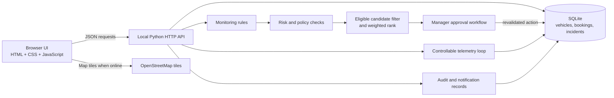

# SmartFleet

SmartFleet is a locally runnable fleet operations dashboard for a vehicle-rental demo. It follows the visual direction and workflow of the supplied SmartFleet reference: incident-first operations, vehicle digital twin, customer-impacting actions with manager review, and transparent simulated notifications.

This workspace has no Node.js/npm installed. To keep the application runnable here without a toolchain install, the UI uses browser-native HTML, CSS, and JavaScript, while the local API uses Python's standard-library HTTP server and SQLite. No `pip install`, `npm install`, or API key is required. The optional India map loads Leaflet and OpenStreetMap tiles when an internet connection is available; table and API workflows remain local.

## Run locally

Requires Python 3.10 or newer.

In PowerShell:

```powershell
Set-Location "$HOME\SmartFleet"
python app.py
```

Open <http://127.0.0.1:8000>. The first launch creates `smartfleet.db` and seeds 24 vehicles, bookings, incidents, an approval request, telemetry, maintenance, notifications, and audit records. Existing demo records persist across restarts.

If port 8000 is busy:

```powershell
$env:PORT = "8001"
python app.py
```

The app is local by default. `SMARTFLEET_HOST`, `PORT`, `SMARTFLEET_DB`, `SMARTFLEET_COST_WITH_REPLACEMENT`, and `SMARTFLEET_COST_WITHOUT_REPLACEMENT` can be set in the environment. Cost values are illustrative INR estimates (defaults ₹1,800 and ₹12,000). See [.env.example](.env.example).

## Demo walkthrough

1. Start at Overview and review metrics, the recorded event chart, and the resilience factors. The score formula and limitations are shown in the UI.
2. Open Incident Center, select an open incident, inspect the evidence, then Approve or Reject the recommendation. Approval marks it Action Ready unless a restricted operation is pending; rejection requires a reason and is audited. Requesting a reassignment creates a manager approval in the default review mode.
3. Open Manager Approvals. Modify the pending replacement, then approve or reject it. Approval rechecks vehicle, safety, service, energy, and booking state before changing the booking.
4. Open Fleet Digital Twin and select a vehicle to open its dedicated `#vehicle/VH-...` detail page. It explains why the vehicle is available, booked, in maintenance, or unsafe, and shows booking, service, incident, location, and telemetry history. Manual safety overrides immediately block dispatch and create an incident.
5. Open What-If Lab and run a preview. The preview does not modify live records. Use Apply scenario only when you want to alter the demo state. Damage dispute and simulated immobilisation scenarios create manager approval requests.
6. Start or pause telemetry simulation in Settings. Booked vehicles lose one energy point per configured cycle; telemetry and audit records are written locally. Safety faults are never generated randomly.
7. Review Notifications and Audit & Replay. Customer communication remains queued in the app and is never sent to a real channel.

## Tests

```powershell
Set-Location "$HOME\SmartFleet"
python -m unittest discover -s tests -v
```

The 21 integration tests cover database-backed metrics, incident deduplication and manager decisions, candidate safety/ranking, booking conflicts, approval execution/modification/staleness, vehicle state explanations, notifications, telemetry history/override, damage dispute escalation, demo immobilisation, simulator history, and what-if isolation.

## Project layout

- `app.py` — SQLite schema/seed, local JSON API, monitoring and policy rules, reassignment scoring, approval flow, simulator, and static-file server.
- `static/index.html` — application shell and accessible dialogs.
- `static/styles.css` — responsive operations dashboard design system.
- `static/app.js` — navigation, data rendering, and browser actions.
- `tests/test_app.py` — API integration suite.
- `docs/architecture.md` — system diagram and data flow.
- `docs/agent-workflow.md` — deterministic agent steps and candidate score.
- `docs/safety-and-policy.md` — non-negotiable rules and demo boundaries.

## API

The browser uses JSON endpoints including:

- `GET /api/state`, `/api/vehicles`, `/api/bookings`, `/api/incidents`, `/api/approvals`, `/api/notifications`, `/api/audit`, `/api/telemetry?vehicle_id=VH-002`
- `GET /api/candidates?booking_id=BK-003`
- `POST /api/monitor`, `/api/reassign`, `/api/approvals/decision`, `/api/bookings`, `/api/notifications`
- `POST /api/telemetry/override`, `/api/simulation/toggle`, `/api/simulation/scenario`, `/api/whatif`, `/api/settings/mode`

The database is initialized idempotently at startup. Set `SMARTFLEET_DB` to a different path to start with a separate clean demo database.

## Known limits

- This is a dependency-free local demo, not the React/Vite + FastAPI stack in the aspirational brief. Node/npm and FastAPI were not available in the supplied environment; the local Python runtime and SQLite were. The app therefore avoids a build step and uses the standard library.
- No WebSocket, external GPS, LLM, SMS/email provider, or real immobilisation integration is connected. The page refreshes data periodically; simulation and notifications are local only.
- The fleet map uses OpenStreetMap tiles centered on India. Its four city clusters group the 24 simulated vehicles by their recorded hub coordinates; cluster status colors highlight the highest-risk vehicle at that hub. Map tiles need internet access. Pickup distances use seeded hub coordinates and a documented 100 km service radius.
- Demo delay/cost figures are illustrative assumptions. The resilience indicator and candidate scores are operational heuristics, not validated predictions.
- The demo schema initializes directly; it does not include a migration framework.

## Complete Project Source

Complete current source, configuration, test, and documentation files follow. The SQLite database is generated locally on first run and is not source code.

### .env.example

````properties
SMARTFLEET_HOST=127.0.0.1
PORT=8000
SMARTFLEET_DB=smartfleet.db
SMARTFLEET_COST_WITH_REPLACEMENT=1800
SMARTFLEET_COST_WITHOUT_REPLACEMENT=12000
````

### .gitignore

````gitignore
__pycache__/
*.py[cod]
*.db
*.db-shm
*.db-wal
````

### app.py

````python
from __future__ import annotations

import json
import math
import os
import sqlite3
import threading
import time
import uuid
from contextlib import contextmanager
from datetime import datetime, timedelta, timezone
from http.server import BaseHTTPRequestHandler, ThreadingHTTPServer
from http.server import BaseHTTPRequestHandler, HTTPServer
from pathlib import Path
from urllib.parse import parse_qs, urlparse

ROOT = Path(__file__).resolve().parent
STATIC = ROOT / "static"
DB_PATH = Path(os.environ.get("SMARTFLEET_DB", ROOT / "smartfleet.db"))
LOCK = threading.RLock()
SIMULATION_WAKE = threading.Event()
SIMULATION = {"running": False, "mode": "Recommend actions", "interval": 15}
DEMO_COST_WITH_REPLACEMENT = int(os.environ.get("SMARTFLEET_COST_WITH_REPLACEMENT", "1800"))
DEMO_COST_WITHOUT_REPLACEMENT = int(os.environ.get("SMARTFLEET_COST_WITHOUT_REPLACEMENT", "12000"))


def now() -> datetime:
    return datetime.now(timezone.utc).replace(microsecond=0)


def stamp(value: datetime | None = None) -> str:
    return (value or now()).isoformat()


@contextmanager
def connect():
    connection = sqlite3.connect(DB_PATH, timeout=10)
    connection.row_factory = sqlite3.Row
    connection.execute("PRAGMA foreign_keys = ON")
    try:
        yield connection
        connection.commit()
    except Exception:
        connection.rollback()
        raise
    finally:
        connection.close()


def record_audit(db: sqlite3.Connection, event: str, entity_type: str, entity_id: str, details: dict) -> None:
    db.execute(
        "INSERT INTO audit_events(id, event, entity_type, entity_id, details, created_at) VALUES(?,?,?,?,?,?)",
        (str(uuid.uuid4()), event, entity_type, entity_id, json.dumps(details), stamp()),
    )


def seed() -> None:
    with LOCK, connect() as db:
        db.executescript("""
        CREATE TABLE IF NOT EXISTS vehicles (
          id TEXT PRIMARY KEY, registration TEXT NOT NULL, make TEXT NOT NULL, model TEXT NOT NULL,
          category TEXT NOT NULL, capacity INTEGER NOT NULL, location TEXT NOT NULL,
          latitude REAL, longitude REAL, energy INTEGER NOT NULL, energy_type TEXT NOT NULL,
          status TEXT NOT NULL, safety TEXT NOT NULL DEFAULT 'SAFE', service_status TEXT NOT NULL DEFAULT 'CLEAR',
          telemetry_at TEXT NOT NULL, current_booking TEXT, notes TEXT DEFAULT ''
        );
        CREATE TABLE IF NOT EXISTS bookings (
          id TEXT PRIMARY KEY, customer TEXT NOT NULL, phone TEXT DEFAULT '', vehicle_id TEXT,
          category TEXT NOT NULL, capacity INTEGER NOT NULL, pickup_location TEXT NOT NULL,
          pickup_at TEXT NOT NULL, return_at TEXT NOT NULL, status TEXT NOT NULL,
          energy_required INTEGER NOT NULL DEFAULT 30, created_at TEXT NOT NULL,
          FOREIGN KEY(vehicle_id) REFERENCES vehicles(id)
        );
        CREATE INDEX IF NOT EXISTS booking_vehicle_window ON bookings(vehicle_id, pickup_at, return_at, status);
        CREATE TABLE IF NOT EXISTS incidents (
          id TEXT PRIMARY KEY, type TEXT NOT NULL, severity TEXT NOT NULL, status TEXT NOT NULL,
          vehicle_id TEXT, booking_id TEXT, summary TEXT NOT NULL, evidence TEXT NOT NULL,
          recommendation TEXT NOT NULL, detected_at TEXT NOT NULL, resolved_at TEXT
        );
        CREATE INDEX IF NOT EXISTS incident_status ON incidents(status, severity);
        CREATE TABLE IF NOT EXISTS approvals (
          id TEXT PRIMARY KEY, incident_id TEXT NOT NULL, operation TEXT NOT NULL,
          reason TEXT NOT NULL, vehicle_id TEXT, booking_id TEXT, proposed_vehicle_id TEXT,
          status TEXT NOT NULL, requested_at TEXT NOT NULL, decided_at TEXT, decided_by TEXT,
          decision_reason TEXT, snapshot TEXT NOT NULL
        );
        CREATE TABLE IF NOT EXISTS notifications (
          id TEXT PRIMARY KEY, recipient TEXT NOT NULL, channel TEXT NOT NULL, message TEXT NOT NULL,
          booking_id TEXT, status TEXT NOT NULL, created_at TEXT NOT NULL
        );
        CREATE TABLE IF NOT EXISTS telemetry (
          id TEXT PRIMARY KEY, vehicle_id TEXT NOT NULL, energy INTEGER NOT NULL, location TEXT NOT NULL,
          safety TEXT NOT NULL, created_at TEXT NOT NULL,
          FOREIGN KEY(vehicle_id) REFERENCES vehicles(id)
        );
        CREATE TABLE IF NOT EXISTS maintenance (
          id TEXT PRIMARY KEY, vehicle_id TEXT NOT NULL, description TEXT NOT NULL,
          status TEXT NOT NULL, scheduled_at TEXT NOT NULL
        );
        CREATE TABLE IF NOT EXISTS agent_recommendations (
          id TEXT PRIMARY KEY, incident_id TEXT NOT NULL, action TEXT NOT NULL,
          evidence TEXT NOT NULL, alternatives TEXT NOT NULL, created_at TEXT NOT NULL
        );
        CREATE TABLE IF NOT EXISTS audit_events (
          id TEXT PRIMARY KEY, event TEXT NOT NULL, entity_type TEXT NOT NULL,
          entity_id TEXT NOT NULL, details TEXT NOT NULL, created_at TEXT NOT NULL
        );
        """)
        if db.execute("SELECT COUNT(*) FROM vehicles").fetchone()[0]:
            approval = db.execute("SELECT id FROM approvals WHERE id='AP-207' AND status='PENDING'").fetchone()
            candidate = db.execute("SELECT * FROM vehicles WHERE id='VH-013'").fetchone()
            booking = db.execute("SELECT * FROM bookings WHERE id='BK-008'").fetchone()
            if approval and candidate and booking:
                snapshot = {"candidate_energy": candidate["energy"], "candidate_status": candidate["status"], "candidate_safety": candidate["safety"], "candidate_service": candidate["service_status"], "booking_vehicle": booking["vehicle_id"], "return_at": booking["return_at"]}
                db.execute("UPDATE approvals SET proposed_vehicle_id=?, snapshot=? WHERE id=?", (candidate["id"], json.dumps(snapshot), approval["id"]))
            maintenance_reasons = {"VH-001": "Scheduled battery system inspection", "VH-008": "High-voltage system diagnostic", "VH-015": "Routine drivetrain service", "VH-022": "Scheduled safety inspection"}
            for vehicle_id, description in maintenance_reasons.items():
                if not db.execute("SELECT 1 FROM maintenance WHERE vehicle_id=? AND status IN ('OPEN','BLOCKING')", (vehicle_id,)).fetchone():
                    db.execute("INSERT INTO maintenance VALUES(?,?,?,?,?)", (f"MT-{vehicle_id}", vehicle_id, description, "BLOCKING", stamp(now()+timedelta(days=1))))
            for vehicle in db.execute("SELECT id,energy,location,safety FROM vehicles").fetchall():
                db.execute("UPDATE telemetry SET energy=?,location=?,safety=? WHERE vehicle_id=? AND typeof(energy)!='integer'", (vehicle["energy"], vehicle["location"], vehicle["safety"], vehicle["id"]))
            return
        makes = [
            ("Tata", "Nexon EV", "SUV", "Electric"), ("Hyundai", "Creta", "SUV", "Fuel"),
            ("Maruti", "Brezza", "Compact", "Fuel"), ("Mahindra", "XUV 700", "SUV", "Fuel"),
            ("Kia", "Seltos", "Compact", "Fuel"), ("MG", "ZS EV", "SUV", "Electric"),
        ]
        hubs = [("Bengaluru", 12.9716, 77.5946), ("Chennai", 13.0827, 80.2707),
                ("Mumbai", 19.0760, 72.8777), ("Hyderabad", 17.3850, 78.4867)]
        vehicles = []
        for i in range(1, 25):
            make, model, category, energy_type = makes[(i - 1) % len(makes)]
            city, lat, lon = hubs[(i - 1) % len(hubs)]
            if i in (5, 17):
                city, lat, lon = hubs[0]
            status, safety, service = "AVAILABLE", "SAFE", "CLEAR"
            energy = 40 + (i * 17) % 58
            if i in (1, 8, 15, 22):
                status, service = "MAINTENANCE", "BLOCKING"
            if i in (4, 16):
                status, safety = "UNSAFE", "FAULT"
            if i in (6, 11, 21):
                status = "BOOKED"
            if i == 8:
                energy = 18
            vehicles.append((f"VH-{i:03}", f"KA-{i:02}-MN-{2200+i}", make, model, category,
                5 if category == "SUV" else 5, city, lat + (i % 5) * .002, lon + (i % 4) * .002,
                energy, energy_type, status, safety, service, stamp(now() - timedelta(minutes=(i % 9) + 1)), None,
                "Brake pressure variance detected across 3 readings." if i in (4, 16) else ""))
        db.executemany("""INSERT INTO vehicles(id,registration,make,model,category,capacity,location,latitude,longitude,
          energy,energy_type,status,safety,service_status,telemetry_at,current_booking,notes) VALUES(?,?,?,?,?,?,?,?,?,?,?,?,?,?,?,?,?)""", vehicles)
        base = now().replace(second=0, microsecond=0)
        booking_rows = [
            ("BK-003", "Aarav Sharma", "+91 90000 10003", "VH-003", "Compact", 4, "Indiranagar hub", stamp(base-timedelta(hours=2)), stamp(base+timedelta(minutes=20)), "OVERDUE", 30, stamp(base-timedelta(days=1))),
            ("BK-006", "Kavya Rao", "+91 90000 10006", "VH-006", "SUV", 4, "Koramangala hub", stamp(base+timedelta(hours=1)), stamp(base+timedelta(hours=5)), "ACTIVE", 35, stamp(base-timedelta(days=1))),
            ("BK-008", "Ishaan Mehta", "+91 90000 10008", "VH-008", "SUV", 4, "Whitefield hub", stamp(base+timedelta(hours=3)), stamp(base+timedelta(hours=8)), "CONFIRMED", 50, stamp(base-timedelta(hours=8))),
            ("BK-011", "Mira Nair", "+91 90000 10011", "VH-011", "Compact", 4, "Bandra hub", stamp(base+timedelta(hours=2)), stamp(base+timedelta(hours=6)), "CONFIRMED", 30, stamp(base-timedelta(hours=6))),
            ("BK-014", "Rohan Das", "+91 90000 10014", "VH-014", "SUV", 4, "Adyar hub", stamp(base+timedelta(hours=6)), stamp(base+timedelta(hours=12)), "CONFIRMED", 30, stamp(base-timedelta(hours=4))),
            ("BK-018", "Anaya Kapoor", "+91 90000 10018", "VH-018", "SUV", 4, "Hitech City hub", stamp(base+timedelta(hours=9)), stamp(base+timedelta(hours=15)), "CONFIRMED", 35, stamp(base-timedelta(hours=2))),
            ("BK-021", "Dev Patel", "+91 90000 10021", "VH-021", "Compact", 4, "Powai hub", stamp(base+timedelta(hours=12)), stamp(base+timedelta(hours=17)), "CONFIRMED", 35, stamp(base-timedelta(hours=1))),
        ]
        db.executemany("INSERT INTO bookings VALUES(?,?,?,?,?,?,?,?,?,?,?,?)", booking_rows)
        for vehicle_id, booking_id in [("VH-003", "BK-003"), ("VH-006", "BK-006"), ("VH-008", "BK-008"), ("VH-011", "BK-011"), ("VH-014", "BK-014"), ("VH-018", "BK-018"), ("VH-021", "BK-021")]:
            db.execute("UPDATE vehicles SET current_booking=? WHERE id=?", (booking_id, vehicle_id))
        incident_rows = [
            ("INC-1042", "Overdue return", "HIGH", "INVESTIGATING", "VH-003", "BK-003", "Return window exceeded by 42 minutes at Indiranagar hub.", json.dumps(["Last telemetry: 12:42 PM", "Customer ETA: 1:20 PM", "Vehicle booked again at 2:00 PM"]), "Protect the next booking; compare eligible replacements and notify the customer.", stamp(base-timedelta(minutes=12)), None),
            ("INC-1041", "Safety fault", "CRITICAL", "DETECTED", "VH-016", None, "Brake pressure variance detected across 3 readings.", json.dumps(["Brake pressure variance: 18%", "Three consecutive readings", "Vehicle status: unsafe"]), "Keep vehicle blocked and escalate to a manager. Do not assign.", stamp(base-timedelta(minutes=24)), None),
            ("INC-1040", "Low battery", "MEDIUM", "AWAITING APPROVAL", "VH-008", "BK-008", "Battery below operating threshold before next booking.", json.dumps(["Battery: 18%", "Required for booking: 50%", "Pickup in 3 hours"]), "Reassign to an eligible SUV after manager approval.", stamp(base-timedelta(minutes=41)), None),
        ]
        db.executemany("INSERT INTO incidents VALUES(?,?,?,?,?,?,?,?,?,?,?)", incident_rows)
        for incident in incident_rows:
            record_audit(db, "Incident detected", "incident", incident[0], {"type": incident[1], "severity": incident[2], "vehicle_id": incident[4], "booking_id": incident[5]})
        db.execute("INSERT INTO approvals VALUES(?,?,?,?,?,?,?,?,?,?,?,?,?)", (
            "AP-207", "INC-1040", "Reassign booking", "Energy below booking requirement; preserve confirmed pickup.",
            "VH-008", "BK-008", "VH-013", "PENDING", stamp(base-timedelta(minutes=20)), None, None, None,
            json.dumps({"candidate_energy": 87, "candidate_status": "AVAILABLE", "candidate_safety": "SAFE", "candidate_service": "CLEAR", "booking_vehicle": "VH-008", "return_at": booking_rows[2][8]})))
        notifications = [
            ("NT-018", "Aarav Sharma", "In-app", "Your vehicle handover is being coordinated by SmartFleet.", "BK-003", "QUEUED", stamp(base-timedelta(minutes=2))),
            ("NT-017", "Kavya Rao", "In-app", "Your pickup is confirmed for 3:30 PM at Koramangala hub.", "BK-006", "DELIVERED (SIMULATED)", stamp(base-timedelta(hours=1))),
            ("NT-016", "Ishaan Mehta", "In-app", "We are checking vehicle readiness before your pickup.", "BK-008", "QUEUED", stamp(base-timedelta(hours=2))),
            ("NT-015", "Mira Nair", "In-app", "Your booking details are confirmed. We look forward to seeing you.", "BK-011", "DELIVERED (SIMULATED)", stamp(base-timedelta(hours=4))),
        ]
        db.executemany("INSERT INTO notifications VALUES(?,?,?,?,?,?,?)", notifications)
        for row in vehicles:
            db.execute("INSERT INTO telemetry VALUES(?,?,?,?,?,?)", (str(uuid.uuid4()), row[0], row[9], row[6], row[12], row[14]))
        db.execute("INSERT INTO maintenance VALUES(?,?,?,?,?)", ("MT-001", "VH-004", "Brake system inspection", "OPEN", stamp(base+timedelta(days=1))))
        maintenance_reasons = {"VH-001": "Scheduled battery system inspection", "VH-008": "High-voltage system diagnostic", "VH-015": "Routine drivetrain service", "VH-022": "Scheduled safety inspection"}
        for vehicle_id, description in maintenance_reasons.items():
            db.execute("INSERT INTO maintenance VALUES(?,?,?,?,?)", (f"MT-{vehicle_id}", vehicle_id, description, "BLOCKING", stamp(base+timedelta(days=1))))
        for event, typ, ident, details in [
            ("Monitoring cycle completed", "system", "monitor-001", {"rules_checked": 8, "incidents_open": 3}),
            ("Safety policy blocked assignment", "vehicle", "VH-016", {"rule": "unsafe_vehicle_block", "result": "blocked"}),
            ("Replacement candidates ranked", "booking", "BK-003", {"eligible_count": 3, "algorithm": "hard filters then weighted score"}),
        ]:
            record_audit(db, event, typ, ident, details)


def rows(db: sqlite3.Connection, table: str, order: str = "") -> list[dict]:
    query = f"SELECT * FROM {table}" + (f" ORDER BY {order}" if order else "")
    return [dict(row) for row in db.execute(query)]


def public_incident(row: dict) -> dict:
    row["evidence"] = json.loads(row["evidence"])
    return row


def vehicle_state_reason(vehicle: dict, bookings: list[dict], incidents: list[dict], maintenance: list[dict]) -> str:
    active_incidents = [item for item in incidents if item["vehicle_id"] == vehicle["id"] and item["status"] not in ("RESOLVED", "REJECTED")]
    if vehicle["status"] == "UNSAFE" or vehicle["safety"] != "SAFE":
        if active_incidents:
            return f"Dispatch blocked: {active_incidents[0]['summary']}"
        if vehicle.get("notes"):
            return f"Dispatch blocked: {vehicle['notes']} Manager inspection is required before release."
        return f"Dispatch blocked because the safety state is {vehicle['safety']}. A manager must clear the fault before use."
    if vehicle["status"] == "MAINTENANCE":
        service = next((item for item in maintenance if item["vehicle_id"] == vehicle["id"] and item["status"] in ("OPEN", "BLOCKING")), None)
        if service:
            return f"Unavailable for service: {service['description']} ({service['status'].lower()})."
        return "Unavailable because the vehicle has a blocking maintenance status; no service note has been recorded yet."
    if vehicle["status"] == "BOOKED":
        booking = next((item for item in bookings if item["id"] == vehicle["current_booking"]), None)
        if booking:
            return f"Reserved for {booking['id']} ({booking['status'].lower()}); pickup at {booking['pickup_location']} on {booking['pickup_at']}."
        return "Marked booked, but no linked booking record was found. Review the vehicle assignment."
    if vehicle["status"] == "CHARGING":
        return f"Unavailable while {vehicle['energy_type'].lower()} energy is being replenished; current level is {vehicle['energy']}%."
    if vehicle["status"] == "AVAILABLE":
        freshness = now() - datetime.fromisoformat(vehicle["telemetry_at"])
        fresh_text = "Telemetry is current." if freshness.total_seconds() <= 30 * 60 else "Telemetry is stale; verify the vehicle before dispatch."
        return f"Available because it has no current booking, safety is clear, and service is not blocking. Energy is {vehicle['energy']}%; {fresh_text}"
    return f"Operating status is {vehicle['status']}; no more specific reason has been recorded."


def state() -> dict:
    with connect() as db:
        vehicles = rows(db, "vehicles", "id")
        bookings = rows(db, "bookings", "pickup_at")
        incidents = [public_incident(x) for x in rows(db, "incidents", "detected_at DESC")]
        approvals = rows(db, "approvals", "requested_at DESC")
        notifications = rows(db, "notifications", "created_at DESC")
        audit = rows(db, "audit_events", "created_at DESC")[:40]
        maintenance_records = rows(db, "maintenance", "scheduled_at DESC")
        for vehicle in vehicles:
            vehicle["state_reason"] = vehicle_state_reason(vehicle, bookings, incidents, maintenance_records)
        for event in audit:
            event["details"] = json.loads(event["details"])
        open_incidents = [item for item in incidents if item["status"] not in ("RESOLVED", "REJECTED")]
        active_bookings = [item for item in bookings if item["status"] in ("ACTIVE", "OVERDUE")]
        upcoming = [item for item in bookings if item["status"] == "CONFIRMED"]
        counts = {status: sum(1 for v in vehicles if v["status"] == status) for status in ("AVAILABLE", "BOOKED", "MAINTENANCE", "UNSAFE", "CHARGING")}
        available_pct = round(counts["AVAILABLE"] / max(1, len(vehicles)) * 100)
        safety_pct = round(sum(v["safety"] == "SAFE" for v in vehicles) / max(1, len(vehicles)) * 100)
        fulfilment_pct = max(0, 100 - 12 * sum(1 for i in open_incidents if i["severity"] in ("HIGH", "CRITICAL")))
        resilience = round(available_pct * .4 + safety_pct * .3 + fulfilment_pct * .3)
        return {"vehicles": vehicles, "bookings": bookings, "incidents": incidents, "approvals": approvals,
            "notifications": notifications, "maintenance": maintenance_records, "audit": audit, "analytics": {
                    "total_vehicles": len(vehicles), "available": counts["AVAILABLE"], "booked": counts["BOOKED"],
                    "maintenance": counts["MAINTENANCE"], "unsafe": counts["UNSAFE"], "active_bookings": len(active_bookings),
                    "upcoming_bookings": len(upcoming), "overdue_returns": sum(b["status"] == "OVERDUE" for b in bookings),
                    "high_priority": sum(i["severity"] in ("HIGH", "CRITICAL") for i in open_incidents),
                    "at_risk": sum(i["status"] not in ("RESOLVED", "REJECTED") and i["booking_id"] is not None for i in incidents),
                    "resilience": resilience, "resilience_factors": {"availability": available_pct, "safety": safety_pct, "fulfilment": fulfilment_pct},
                    "open_incidents": len(open_incidents), "automation_mode": SIMULATION["mode"], "simulation_running": SIMULATION["running"]}}


def candidates(db: sqlite3.Connection, booking: sqlite3.Row) -> list[dict]:
    all_vehicles = db.execute("SELECT * FROM vehicles WHERE id != ?", (booking["vehicle_id"],)).fetchall()
    ranked = []
    start, end = booking["pickup_at"], booking["return_at"]
    for vehicle in all_vehicles:
        reasons = []
        if vehicle["safety"] != "SAFE" or vehicle["status"] == "UNSAFE": reasons.append("safety fault or unsafe")
        if vehicle["service_status"] == "BLOCKING" or vehicle["status"] == "MAINTENANCE": reasons.append("blocking maintenance")
        if vehicle["category"] != booking["category"]: reasons.append("category mismatch")
        if vehicle["capacity"] < booking["capacity"]: reasons.append("insufficient passenger capacity")
        if vehicle["energy"] < booking["energy_required"]: reasons.append("insufficient energy")
        overlap = db.execute("SELECT 1 FROM bookings WHERE vehicle_id=? AND status IN ('ACTIVE','OVERDUE','CONFIRMED') AND pickup_at < ? AND return_at > ? LIMIT 1", (vehicle["id"], end, start)).fetchone()
        if overlap: reasons.append("booking overlap")
        if reasons: continue
        pickup = booking["pickup_location"].split()[0].lower()
        pickup_aliases = {"indiranagar": "Bengaluru", "koramangala": "Bengaluru", "whitefield": "Bengaluru", "powai": "Mumbai", "bandra": "Mumbai", "adyar": "Chennai", "hitech": "Hyderabad"}
        pickup_city = pickup_aliases.get(pickup, pickup.title())
        coordinates = {"Bengaluru": (12.9716, 77.5946), "Chennai": (13.0827, 80.2707), "Mumbai": (19.0760, 72.8777), "Hyderabad": (17.3850, 78.4867)}
        target_lat, target_lon = coordinates.get(pickup_city, (vehicle["latitude"], vehicle["longitude"]))
        lat1, lat2 = math.radians(target_lat), math.radians(vehicle["latitude"])
        delta_lat = lat2 - lat1
        delta_lon = math.radians(vehicle["longitude"] - target_lon)
        arc = math.sin(delta_lat / 2) ** 2 + math.cos(lat1) * math.cos(lat2) * math.sin(delta_lon / 2) ** 2
        distance = 6371 * 2 * math.atan2(math.sqrt(arc), math.sqrt(1 - arc))
        if distance > 100: continue
        energy_score = min(100, vehicle["energy"])
        proximity_score = max(0, 100 - distance * 8)
        disruption = 100 if vehicle["location"] == pickup_city else 78
        score = round(proximity_score * .35 + energy_score * .25 + disruption * .25 + 85 * .15)
        ranked.append({"vehicle_id": vehicle["id"], "make": vehicle["make"], "model": vehicle["model"], "location": vehicle["location"], "energy": vehicle["energy"], "score": score, "distance_km": round(distance, 1), "breakdown": {"pickup_proximity": round(proximity_score), "energy_sufficiency": energy_score, "customer_disruption": disruption, "schedule_slack": 85}, "reason": "Eligible: safety clear, compatible class, sufficient energy, no overlapping booking."})
    return sorted(ranked, key=lambda item: item["score"], reverse=True)


def monitor() -> list[dict]:
    created = []
    with LOCK, connect() as db:
        vehicles = db.execute("SELECT * FROM vehicles").fetchall()
        active_bookings = db.execute("SELECT * FROM bookings WHERE status IN ('ACTIVE','OVERDUE','CONFIRMED')").fetchall()
        checks = []
        for booking in active_bookings:
            if not booking["vehicle_id"]:
                continue
            vehicle = db.execute("SELECT * FROM vehicles WHERE id=?", (booking["vehicle_id"],)).fetchone()
            booking_status = booking["status"]
            if booking_status in ("ACTIVE", "CONFIRMED") and datetime.fromisoformat(booking["return_at"]) < now():
                booking_status = "OVERDUE"
                db.execute("UPDATE bookings SET status='OVERDUE' WHERE id=?", (booking["id"],))
                record_audit(db, "Booking return became overdue", "booking", booking["id"], {"vehicle_id": booking["vehicle_id"], "return_at": booking["return_at"]})
            if booking_status == "OVERDUE":
                checks.append(("Overdue return", "HIGH", vehicle["id"], booking["id"], f"{booking['id']} passed its expected return time.", [f"Customer: {booking['customer']}", f"Return window: {booking['return_at']}", f"Vehicle: {vehicle['id']}"], "Check customer ETA and protect the next booking."))
            if vehicle["energy"] < booking["energy_required"]:
                checks.append(("Low battery", "MEDIUM", vehicle["id"], booking["id"], f"{vehicle['energy']}% energy is below {booking['energy_required']}% required for {booking['id']}.", [f"Current energy: {vehicle['energy']}%", f"Required: {booking['energy_required']}%", f"Pickup: {booking['pickup_at']}"], "Find a compatible replacement or charge before dispatch."))
            if vehicle["safety"] != "SAFE":
                checks.append(("Safety fault", "CRITICAL", vehicle["id"], booking["id"], f"{vehicle['id']} has an active safety fault.", ["Safety status is not clear", "Assignments blocked by policy"], "Block dispatch and escalate to the manager."))
        for vehicle in vehicles:
            if vehicle["safety"] != "SAFE" and not any(c[2] == vehicle["id"] and c[0] == "Safety fault" for c in checks):
                checks.append(("Safety fault", "CRITICAL", vehicle["id"], None, f"{vehicle['id']} has an active safety fault.", ["Safety status is not clear", "Assignments blocked by policy"], "Keep the vehicle out of service and escalate."))
        for vehicle in vehicles:
            freshness = now() - datetime.fromisoformat(vehicle["telemetry_at"])
            if freshness.total_seconds() > 30 * 60:
                checks.append(("Telemetry unavailable", "MEDIUM", vehicle["id"], None, f"Telemetry for {vehicle['id']} is stale.", [f"Last reading: {vehicle['telemetry_at']}", f"Age: {int(freshness.total_seconds() // 60)} minutes"], "Verify the device feed before dispatch."))
        for typ, severity, vehicle_id, booking_id, summary, evidence, recommendation in checks:
            exists = db.execute("SELECT 1 FROM incidents WHERE type=? AND vehicle_id IS ? AND booking_id IS ? AND status NOT IN ('RESOLVED','REJECTED')", (typ, vehicle_id, booking_id)).fetchone()
            if exists: continue
            incident_id = f"INC-{int(time.time())}-{uuid.uuid4().hex[:6]}"
            db.execute("INSERT INTO incidents VALUES(?,?,?,?,?,?,?,?,?,?,?)", (incident_id, typ, severity, "DETECTED", vehicle_id, booking_id, summary, json.dumps(evidence), recommendation, stamp(), None))
            db.execute("INSERT INTO agent_recommendations VALUES(?,?,?,?,?,?)", (str(uuid.uuid4()), incident_id, recommendation, json.dumps(evidence), json.dumps([]), stamp()))
            record_audit(db, "Incident detected", "incident", incident_id, {"type": typ, "severity": severity, "vehicle_id": vehicle_id, "booking_id": booking_id})
            created.append({"id": incident_id, "type": typ, "summary": summary})
        record_audit(db, "Monitoring cycle completed", "system", "monitor", {"checks": len(checks), "new_incidents": len(created)})
    return created


def response(handler: BaseHTTPRequestHandler, status: int, data: dict | list | None = None, content_type: str = "application/json") -> None:
    body = (json.dumps(data, default=str) if content_type == "application/json" else str(data)).encode("utf-8")
    handler.send_response(status)
    handler.send_header("Content-Type", f"{content_type}; charset=utf-8")
    handler.send_header("Content-Length", str(len(body)))
    handler.send_header("Cache-Control", "no-store")
    handler.send_header("Access-Control-Allow-Origin", "*")
    handler.send_header("Access-Control-Allow-Headers", "Content-Type")
    handler.send_header("Access-Control-Allow-Methods", "GET,POST,PATCH,OPTIONS")
    handler.end_headers()
    handler.wfile.write(body)


class SmartFleetHandler(BaseHTTPRequestHandler):
    def log_message(self, fmt: str, *args) -> None:
        print(f"{self.address_string()} - {fmt % args}")

    def body(self) -> dict:
        length = min(int(self.headers.get("Content-Length", "0")), 1_000_000)
        return json.loads(self.rfile.read(length) or b"{}")

    def do_OPTIONS(self) -> None:
        response(self, 204, {})

    def do_GET(self) -> None:
        path = urlparse(self.path).path
        if path == "/api/state":
            return response(self, 200, state())
        if path == "/api/health":
            return response(self, 200, {"ok": True, "database": str(DB_PATH.name)})
        if path == "/api/telemetry":
            vehicle_id = parse_qs(urlparse(self.path).query).get("vehicle_id", [""])[0]
            with connect() as db:
                if not db.execute("SELECT 1 FROM vehicles WHERE id=?", (vehicle_id,)).fetchone():
                    return response(self, 404, {"error": "Vehicle not found"})
                readings = [dict(row) for row in db.execute("SELECT energy,location,safety,created_at FROM telemetry WHERE vehicle_id=? ORDER BY created_at DESC LIMIT 50", (vehicle_id,))]
            return response(self, 200, {"vehicle_id": vehicle_id, "readings": readings})
        if path == "/api/candidates":
            booking_id = urlparse(self.path).query.replace("booking_id=", "")
            with connect() as db:
                booking = db.execute("SELECT * FROM bookings WHERE id=?", (booking_id,)).fetchone()
                if not booking: return response(self, 404, {"error": "Booking not found"})
                return response(self, 200, {"candidates": candidates(db, booking)})
        if path.startswith("/api/"):
            key = path.removeprefix("/api/")
            mapping = {"vehicles": "vehicles", "bookings": "bookings", "incidents": "incidents", "approvals": "approvals", "notifications": "notifications", "audit": "audit_events"}
            if key in mapping:
                with connect() as db: return response(self, 200, rows(db, mapping[key], "created_at DESC" if key in ("notifications", "audit") else "id"))
            return response(self, 404, {"error": "API route not found"})
        if path == "/" or path == "/index.html":
            file = STATIC / "index.html"
        else:
            file = (STATIC / path.lstrip("/")).resolve()
            if STATIC.resolve() not in file.parents: return response(self, 403, "Forbidden", "text/plain")
        if not file.is_file(): return response(self, 404, "Not found", "text/plain")
        content_type = {".html": "text/html", ".css": "text/css", ".js": "application/javascript", ".svg": "image/svg+xml"}.get(file.suffix, "application/octet-stream")
        return response(self, 200, file.read_text(encoding="utf-8"), content_type)

    def do_POST(self) -> None:
        path = urlparse(self.path).path
        try:
            payload = self.body()
        except (ValueError, UnicodeDecodeError):
            return response(self, 400, {"error": "Request body must be valid JSON"})
        if path == "/api/monitor":
            return response(self, 200, {"created": monitor()})
        if path == "/api/incidents/decision":
            return self.decide_incident(payload)
        if path == "/api/settings/mode":
            mode = payload.get("mode")
            if mode not in ("Observe only", "Recommend actions", "Approval required", "Automation ON"):
                return response(self, 400, {"error": "Invalid automation mode"})
            SIMULATION["mode"] = mode
            return response(self, 200, {"mode": mode})
        if path == "/api/simulation/toggle":
            SIMULATION["running"] = bool(payload.get("running"))
            SIMULATION_WAKE.set()
            record_simple_audit("Simulation " + ("started" if SIMULATION["running"] else "paused"), "simulation", "main", {"running": SIMULATION["running"]})
            return response(self, 200, {"running": SIMULATION["running"]})
        if path == "/api/telemetry/override":
            return self.telemetry_override(payload)
        if path == "/api/simulation/scenario":
            return self.scenario(payload)
        if path == "/api/whatif":
            return self.whatif(payload)
        if path == "/api/reassign":
            return self.reassign(payload)
        if path == "/api/approvals/decision":
            return self.decide(payload)
        if path == "/api/bookings":
            return self.create_booking(payload)
        if path == "/api/notifications":
            with LOCK, connect() as db:
                booking = db.execute("SELECT customer FROM bookings WHERE id=?", (payload.get("booking_id"),)).fetchone()
                if not booking: return response(self, 404, {"error": "Related booking not found"})
                notification_id = f"NT-{int(time.time())}"
                db.execute("INSERT INTO notifications VALUES(?,?,?,?,?,?,?)", (notification_id, booking["customer"], "In-app", str(payload.get("message", ""))[:500], payload["booking_id"], "QUEUED", stamp()))
                record_audit(db, "Simulated notification queued", "notification", notification_id, {"booking_id": payload["booking_id"], "delivery": "not sent externally"})
            return response(self, 201, {"id": notification_id, "status": "QUEUED"})
        return response(self, 404, {"error": "API route not found"})

    def decide_incident(self, payload: dict) -> None:
        incident_id = str(payload.get("incident_id", ""))
        decision = payload.get("decision")
        if decision not in ("approve", "reject"):
            return response(self, 400, {"error": "Decision must be approve or reject"})
        reason = str(payload.get("reason", "")).strip()[:500]
        if decision == "reject" and not reason:
            return response(self, 400, {"error": "A reason is required to reject an incident recommendation"})
        with LOCK, connect() as db:
            db.execute("BEGIN IMMEDIATE")
            incident = db.execute("SELECT * FROM incidents WHERE id=?", (incident_id,)).fetchone()
            if not incident:
                return response(self, 404, {"error": "Incident not found"})
            if incident["status"] in ("RESOLVED", "REJECTED"):
                return response(self, 409, {"error": "This incident is already closed"})
            if decision == "approve":
                status = "ACTION READY"
                db.execute("UPDATE incidents SET status=? WHERE id=?", (status, incident_id))
                record_audit(db, "Incident recommendation approved", "incident", incident_id, {"manager": payload.get("manager", "Arjun Singh"), "next_step": "Action is ready; restricted operations still require their own approval."})
            else:
                status = "REJECTED"
                db.execute("UPDATE incidents SET status=?,resolved_at=? WHERE id=?", (status, stamp(), incident_id))
                pending = db.execute("SELECT id FROM approvals WHERE incident_id=? AND status='PENDING'", (incident_id,)).fetchall()
                for approval in pending:
                    db.execute("UPDATE approvals SET status='REJECTED',decided_at=?,decided_by=?,decision_reason=? WHERE id=?", (stamp(), payload.get("manager", "Arjun Singh"), reason, approval["id"]))
                    record_audit(db, "Related approval rejected with incident", "approval", approval["id"], {"incident_id": incident_id, "reason": reason})
                record_audit(db, "Incident recommendation rejected", "incident", incident_id, {"manager": payload.get("manager", "Arjun Singh"), "reason": reason})
        return response(self, 200, {"incident_id": incident_id, "status": status})

    def telemetry_override(self, payload: dict) -> None:
        vehicle_id = payload.get("vehicle_id")
        energy, location, safety = payload.get("energy"), payload.get("location"), payload.get("safety")
        if energy is not None and (not isinstance(energy, int) or not 0 <= energy <= 100):
            return response(self, 400, {"error": "Energy must be an integer from 0 to 100"})
        if safety is not None and safety not in ("SAFE", "FAULT"):
            return response(self, 400, {"error": "Safety must be SAFE or FAULT"})
        if location is not None and (not isinstance(location, str) or not location.strip() or len(location) > 100):
            return response(self, 400, {"error": "Location must contain 1 to 100 characters"})
        with LOCK, connect() as db:
            vehicle = db.execute("SELECT * FROM vehicles WHERE id=?", (vehicle_id,)).fetchone()
            if not vehicle: return response(self, 404, {"error": "Vehicle not found"})
            next_energy = vehicle["energy"] if energy is None else energy
            next_location = vehicle["location"] if location is None else location.strip()
            next_safety = vehicle["safety"] if safety is None else safety
            next_status = "UNSAFE" if next_safety != "SAFE" else vehicle["status"]
            event_time = stamp()
            db.execute("UPDATE vehicles SET energy=?,location=?,safety=?,status=?,telemetry_at=? WHERE id=?", (next_energy, next_location, next_safety, next_status, event_time, vehicle_id))
            db.execute("INSERT INTO telemetry VALUES(?,?,?,?,?,?)", (str(uuid.uuid4()), vehicle_id, next_energy, next_location, next_safety, event_time))
            record_audit(db, "Manual telemetry override", "vehicle", vehicle_id, {"energy": next_energy, "location": next_location, "safety": next_safety})
        if next_safety != "SAFE": monitor()
        return response(self, 200, {"vehicle_id": vehicle_id, "energy": next_energy, "location": next_location, "safety": next_safety, "status": next_status})

    def scenario(self, payload: dict) -> None:
        scenario = payload.get("scenario")
        allowed = {"Vehicle breakdown", "Overdue return", "Booking surge", "Low battery", "Safety fault", "Damage dispute", "Telemetry loss", "Immobilisation request"}
        if scenario not in allowed: return response(self, 400, {"error": "Unknown demo scenario"})
        if payload.get("apply"):
            vehicle_id = payload.get("vehicle_id", "VH-003")
            with LOCK, connect() as db:
                vehicle = db.execute("SELECT * FROM vehicles WHERE id=?", (vehicle_id,)).fetchone()
                if not vehicle: return response(self, 404, {"error": "Vehicle not found"})
                if scenario in ("Vehicle breakdown", "Safety fault"):
                    db.execute("UPDATE vehicles SET status='UNSAFE', safety='FAULT', notes=? WHERE id=?", (scenario, vehicle_id))
                elif scenario == "Low battery":
                    db.execute("UPDATE vehicles SET energy=12 WHERE id=?", (vehicle_id,))
                elif scenario == "Telemetry loss":
                    db.execute("UPDATE vehicles SET telemetry_at=? WHERE id=?", (stamp(now()-timedelta(hours=3)), vehicle_id))
                elif scenario == "Overdue return":
                    changed = db.execute("UPDATE bookings SET status='OVERDUE', return_at=? WHERE vehicle_id=? AND status IN ('ACTIVE','CONFIRMED')", (stamp(now()-timedelta(minutes=42)), vehicle_id)).rowcount
                    if not changed:
                        booking_id = f"BK-SIM-{uuid.uuid4().hex[:8]}"
                        db.execute("INSERT INTO bookings VALUES(?,?,?,?,?,?,?,?,?,?,?,?)", (booking_id, "Scenario Customer", "", vehicle_id, vehicle["category"], 4, f"{vehicle['location']} hub", stamp(now()-timedelta(hours=3)), stamp(now()-timedelta(minutes=42)), "OVERDUE", 30, stamp()))
                        db.execute("UPDATE vehicles SET current_booking=? WHERE id=?", (booking_id, vehicle_id))
                        record_audit(db, "Scenario overdue booking created", "booking", booking_id, {"vehicle_id": vehicle_id})
                elif scenario == "Booking surge":
                    for _ in range(3):
                        booking_id = f"BK-SIM-{uuid.uuid4().hex[:8]}"
                        pickup_at = now() + timedelta(hours=1)
                        db.execute("INSERT INTO bookings VALUES(?,?,?,?,?,?,?,?,?,?,?,?)", (booking_id, "Scenario Customer", "", None, "Compact", 4, "Bengaluru hub", stamp(pickup_at), stamp(pickup_at+timedelta(hours=4)), "CONFIRMED", 30, stamp()))
                        record_audit(db, "Booking surge request created", "booking", booking_id, {"scenario": scenario, "vehicle_assigned": False})
                elif scenario == "Damage dispute":
                    incident_id = f"INC-{int(time.time())}"
                    incident_id = f"INC-{int(time.time())}-{uuid.uuid4().hex[:6]}"
                    approval_id = f"AP-{int(time.time())}-{uuid.uuid4().hex[:6]}"
                    db.execute("INSERT INTO incidents VALUES(?,?,?,?,?,?,?,?,?,?,?)", (incident_id, scenario, "HIGH", "AWAITING APPROVAL", vehicle_id, vehicle["current_booking"], f"Damage dispute reported for {vehicle_id}; liability not determined.", json.dumps(["Reported damage requires manager review", "No liability conclusion has been made"]), "Preserve evidence and request manager review.", stamp(), None))
                    db.execute("INSERT INTO approvals VALUES(?,?,?,?,?,?,?,?,?,?,?,?,?)", (approval_id, incident_id, "Damage dispute review", "Manager review required; the agent has made no liability decision.", vehicle_id, vehicle["current_booking"], vehicle_id, "PENDING", stamp(), None, None, None, json.dumps({"vehicle_id": vehicle_id, "vehicle_status": vehicle["status"], "safety": vehicle["safety"]})))
                    record_audit(db, "Damage dispute escalated", "incident", incident_id, {"approval_id": approval_id, "liability": "undetermined"})
                elif scenario == "Immobilisation request":
                    reason = str(payload.get("reason", "")).strip()
                    if not reason: return response(self, 400, {"error": "A documented reason is required"})
                    incident_id = f"INC-{int(time.time())}"
                    incident_id = f"INC-{int(time.time())}-{uuid.uuid4().hex[:6]}"
                    approval_id = f"AP-{int(time.time())}-{uuid.uuid4().hex[:6]}"
                    db.execute("INSERT INTO incidents VALUES(?,?,?,?,?,?,?,?,?,?,?)", (incident_id, scenario, "HIGH", "AWAITING APPROVAL", vehicle_id, vehicle["current_booking"], f"Simulated immobilisation requested for {vehicle_id}.", json.dumps([f"Manager reason: {reason}", "No physical vehicle control is connected"]), "Manager approval required. This request changes demo state only.", stamp(), None))
                    db.execute("INSERT INTO approvals VALUES(?,?,?,?,?,?,?,?,?,?,?,?,?)", (approval_id, incident_id, "Simulated immobilisation", reason, vehicle_id, vehicle["current_booking"], vehicle_id, "PENDING", stamp(), None, None, None, json.dumps({"vehicle_id": vehicle_id, "vehicle_status": vehicle["status"], "safety": vehicle["safety"]})))
                    record_audit(db, "Simulated immobilisation approval requested", "incident", incident_id, {"approval_id": approval_id, "physical_action": False})
                record_audit(db, "Scenario applied to live demo data", "vehicle", vehicle_id, {"scenario": scenario})
            monitor()
            return response(self, 200, {"applied": True, "scenario": scenario})
        return response(self, 200, self.scenario_projection(scenario))

    def scenario_projection(self, scenario: str) -> dict:
        data = state()
        affected = [b for b in data["bookings"] if b["status"] in ("CONFIRMED", "ACTIVE", "OVERDUE")][:3]
        with connect() as db:
            options = candidates(db, db.execute("SELECT * FROM bookings WHERE id=?", (affected[0]["id"],)).fetchone()) if affected else []
        return {"scenario": scenario, "bookings_affected": len(affected), "booking_refs": [b["id"] for b in affected],
                "eligible_replacements": len(options), "top_options": options[:3], "unresolved_conflicts": max(0, len(affected)-len(options)),
                "estimated_delay_minutes": 18 if options else 75, "estimated_cost_impact": DEMO_COST_WITH_REPLACEMENT if options else DEMO_COST_WITHOUT_REPLACEMENT,
            "approval_required": scenario in ("Safety fault", "Damage dispute", "Vehicle breakdown", "Immobilisation request"),
                "outcome": "Projected only; live records are unchanged until Apply scenario is selected."}

    def whatif(self, payload: dict) -> None:
        scenario = payload.get("scenario", "Vehicle breakdown")
        if scenario not in {"Vehicle breakdown", "Overdue return", "Booking surge", "Low battery", "Safety fault", "Damage dispute", "Telemetry loss", "Immobilisation request"}:
            return response(self, 400, {"error": "Unknown scenario"})
        return response(self, 200, self.scenario_projection(scenario))

    def reassign(self, payload: dict) -> None:
        booking_id, vehicle_id = payload.get("booking_id"), payload.get("vehicle_id")
        with LOCK, connect() as db:
            db.execute("BEGIN IMMEDIATE")
            booking = db.execute("SELECT * FROM bookings WHERE id=?", (booking_id,)).fetchone()
            vehicle = db.execute("SELECT * FROM vehicles WHERE id=?", (vehicle_id,)).fetchone()
            if not booking or not vehicle: return response(self, 404, {"error": "Booking or vehicle not found"})
            eligible = candidates(db, booking)
            candidate = next((item for item in eligible if item["vehicle_id"] == vehicle_id), None)
            if not candidate: return response(self, 409, {"error": "Vehicle fails one or more safety, maintenance, compatibility, energy or schedule checks."})
            incident = db.execute("SELECT severity FROM incidents WHERE id=?", (payload.get("incident_id"),)).fetchone()
            if SIMULATION["mode"] == "Observe only":
                return response(self, 409, {"error": "Observe-only mode blocks booking changes"})
            approval_required = bool(payload.get("approval_required")) or SIMULATION["mode"] != "Automation ON" or bool(incident and incident["severity"] in ("HIGH", "CRITICAL"))
            if approval_required:
                existing = db.execute("SELECT id FROM approvals WHERE booking_id=? AND proposed_vehicle_id=? AND status='PENDING' LIMIT 1", (booking_id, vehicle_id)).fetchone()
                if existing:
                    return response(self, 200, {"approval_id": existing["id"], "status": "PENDING", "candidate": candidate})
                approval_id = f"AP-{int(time.time())}-{uuid.uuid4().hex[:6]}"
                snapshot = {"booking_vehicle": booking["vehicle_id"], "candidate_energy": vehicle["energy"], "candidate_status": vehicle["status"], "candidate_safety": vehicle["safety"], "candidate_service": vehicle["service_status"], "return_at": booking["return_at"]}
                db.execute("INSERT INTO approvals VALUES(?,?,?,?,?,?,?,?,?,?,?,?,?)", (approval_id, payload.get("incident_id", "INC-1042"), "Reassign booking", "Manager review requested for customer-impacting change.", booking["vehicle_id"], booking_id, vehicle_id, "PENDING", stamp(), None, None, None, json.dumps(snapshot)))
                record_audit(db, "Approval requested", "approval", approval_id, snapshot)
                return response(self, 201, {"approval_id": approval_id, "status": "PENDING", "candidate": candidate})
            return self.apply_reassignment(db, booking, vehicle, candidate)

    def apply_reassignment(self, db: sqlite3.Connection, booking: sqlite3.Row, vehicle: sqlite3.Row, candidate: dict) -> None:
        old_vehicle_id = booking["vehicle_id"]
        db.execute("UPDATE bookings SET vehicle_id=? WHERE id=?", (vehicle["id"], booking["id"]))
        db.execute("UPDATE vehicles SET current_booking=NULL, status='AVAILABLE' WHERE id=?", (old_vehicle_id,))
        db.execute("UPDATE vehicles SET current_booking=?, status='BOOKED' WHERE id=?", (booking["id"], vehicle["id"]))
        db.execute("UPDATE incidents SET status='RESOLVED', resolved_at=? WHERE booking_id=? AND status NOT IN ('RESOLVED','REJECTED')", (stamp(), booking["id"]))
        message = f"Your booking vehicle has been updated to {vehicle['make']} {vehicle['model']} ({vehicle['id']}). Pickup remains at {booking['pickup_location']}."
        notice_id = f"NT-{int(time.time())}"
        db.execute("INSERT INTO notifications VALUES(?,?,?,?,?,?,?)", (notice_id, booking["customer"], "In-app", message, booking["id"], "QUEUED", stamp()))
        record_audit(db, "Booking reassigned", "booking", booking["id"], {"from": old_vehicle_id, "to": vehicle["id"], "score": candidate["score"]})
        record_audit(db, "Simulated customer notification queued", "notification", notice_id, {"booking_id": booking["id"], "delivery": "queued; not sent externally"})
        return response(self, 200, {"booking_id": booking["id"], "vehicle_id": vehicle["id"], "notification_id": notice_id, "status": "REASSIGNED"})

    def decide(self, payload: dict) -> None:
        approval_id, decision = payload.get("approval_id"), payload.get("decision")
        if decision not in ("approve", "reject", "modify"): return response(self, 400, {"error": "Decision must be approve, reject or modify"})
        with LOCK, connect() as db:
            db.execute("BEGIN IMMEDIATE")
            approval = db.execute("SELECT * FROM approvals WHERE id=?", (approval_id,)).fetchone()
            if not approval: return response(self, 404, {"error": "Approval not found"})
            if approval["status"] != "PENDING": return response(self, 409, {"error": "Approval has already been decided"})
            if decision == "modify":
                if approval["operation"] != "Reassign booking": return response(self, 409, {"error": "This approval does not support changing a replacement vehicle"})
                booking = db.execute("SELECT * FROM bookings WHERE id=?", (approval["booking_id"],)).fetchone()
                current = json.loads(approval["snapshot"])
                if not booking or booking["vehicle_id"] != current["booking_vehicle"] or booking["return_at"] != current["return_at"]:
                    return response(self, 409, {"error": "Approval is stale because the booking changed"})
                vehicle = db.execute("SELECT * FROM vehicles WHERE id=?", (payload.get("vehicle_id"),)).fetchone()
                candidate = next((item for item in candidates(db, booking) if vehicle and item["vehicle_id"] == vehicle["id"]), None)
                if not candidate: return response(self, 409, {"error": "Modified vehicle fails current policy checks"})
                snapshot = {"booking_vehicle": booking["vehicle_id"], "candidate_energy": vehicle["energy"], "candidate_status": vehicle["status"], "candidate_safety": vehicle["safety"], "candidate_service": vehicle["service_status"], "return_at": booking["return_at"]}
                db.execute("UPDATE approvals SET proposed_vehicle_id=?, snapshot=?, reason=? WHERE id=?", (vehicle["id"], json.dumps(snapshot), payload.get("reason", "Manager modified proposed vehicle"), approval_id))
                record_audit(db, "Approval recommendation modified", "approval", approval_id, {"proposed_vehicle_id": vehicle["id"], "score": candidate["score"]})
                return response(self, 200, {"status": "PENDING", "proposed_vehicle_id": vehicle["id"]})
            if decision == "reject":
                db.execute("UPDATE approvals SET status='REJECTED', decided_at=?, decided_by=?, decision_reason=? WHERE id=?", (stamp(), payload.get("manager", "Arjun Singh"), payload.get("reason", "Rejected by manager"), approval_id))
                db.execute("UPDATE incidents SET status='REJECTED', resolved_at=? WHERE id=? AND status NOT IN ('RESOLVED','REJECTED')", (stamp(), approval["incident_id"]))
                record_audit(db, "Approval rejected", "approval", approval_id, {"reason": payload.get("reason", "Rejected by manager")})
                record_audit(db, "Incident recommendation rejected", "incident", approval["incident_id"], {"approval_id": approval_id, "reason": payload.get("reason", "Rejected by manager")})
                return response(self, 200, {"status": "REJECTED"})
            if approval["operation"] in ("Damage dispute review", "Simulated immobilisation"):
                snapshot = json.loads(approval["snapshot"])
                vehicle = db.execute("SELECT * FROM vehicles WHERE id=?", (approval["vehicle_id"],)).fetchone()
                if not vehicle or vehicle["status"] != snapshot["vehicle_status"] or vehicle["safety"] != snapshot["safety"]:
                    db.execute("UPDATE approvals SET status='STALE', decided_at=?, decided_by=?, decision_reason=? WHERE id=?", (stamp(), payload.get("manager", "Arjun Singh"), "Vehicle state changed since the request.", approval_id))
                    record_audit(db, "Stale approval rejected", "approval", approval_id, {"reason": "Vehicle state changed since request"})
                    return response(self, 409, {"error": "Approval is stale because the vehicle changed. Run the agent again."})
                if approval["operation"] == "Simulated immobilisation":
                    db.execute("UPDATE vehicles SET status='UNSAFE', safety='FAULT', notes='Simulated immobilisation approved; no physical control.' WHERE id=?", (vehicle["id"],))
                    record_audit(db, "Simulated immobilisation approved", "vehicle", vehicle["id"], {"physical_action": False, "manager": payload.get("manager", "Arjun Singh")})
                else:
                    db.execute("UPDATE incidents SET status='INVESTIGATING' WHERE id=?", (approval["incident_id"],))
                    record_audit(db, "Damage dispute assigned for manager handling", "incident", approval["incident_id"], {"liability": "undetermined", "manager": payload.get("manager", "Arjun Singh")})
                db.execute("UPDATE approvals SET status='APPROVED', decided_at=?, decided_by=? WHERE id=?", (stamp(), payload.get("manager", "Arjun Singh"), approval_id))
                return response(self, 200, {"status": "APPROVED", "operation": approval["operation"], "physical_action": False})
            booking = db.execute("SELECT * FROM bookings WHERE id=?", (approval["booking_id"],)).fetchone()
            vehicle = db.execute("SELECT * FROM vehicles WHERE id=?", (approval["proposed_vehicle_id"],)).fetchone()
            snapshot = json.loads(approval["snapshot"])
            if not booking or not vehicle or booking["vehicle_id"] != snapshot["booking_vehicle"] or booking["return_at"] != snapshot["return_at"] or vehicle["energy"] != snapshot["candidate_energy"] or vehicle["status"] != snapshot.get("candidate_status", vehicle["status"]) or vehicle["safety"] != snapshot.get("candidate_safety", vehicle["safety"]) or vehicle["service_status"] != snapshot.get("candidate_service", vehicle["service_status"]):
                db.execute("UPDATE approvals SET status='STALE', decided_at=?, decided_by=?, decision_reason=? WHERE id=?", (stamp(), payload.get("manager", "Arjun Singh"), "Underlying vehicle or booking changed since request.", approval_id))
                record_audit(db, "Stale approval rejected", "approval", approval_id, {"reason": "State changed since recommendation"})
                return response(self, 409, {"error": "Approval is stale because the vehicle or booking changed. Run the agent again."})
            candidate = next((item for item in candidates(db, booking) if item["vehicle_id"] == vehicle["id"]), None)
            if not candidate: return response(self, 409, {"error": "Current policy checks reject this assignment."})
            db.execute("UPDATE approvals SET status='APPROVED', decided_at=?, decided_by=? WHERE id=?", (stamp(), payload.get("manager", "Arjun Singh"), approval_id))
            result = self.apply_reassignment(db, booking, vehicle, candidate)
            record_audit(db, "Approval executed", "approval", approval_id, {"manager": payload.get("manager", "Arjun Singh")})
            return result

    def create_booking(self, payload: dict) -> None:
        required = ("customer", "category", "pickup_location", "pickup_at", "return_at")
        if any(not str(payload.get(field, "")).strip() for field in required): return response(self, 400, {"error": "Customer, category, pickup location and time window are required"})
        if payload["return_at"] <= payload["pickup_at"]: return response(self, 400, {"error": "Return time must be after pickup time"})
        booking_id = f"BK-{int(time.time())}"
        vehicle_id = payload.get("vehicle_id") or None
        with LOCK, connect() as db:
            if vehicle_id:
                vehicle = db.execute("SELECT * FROM vehicles WHERE id=?", (vehicle_id,)).fetchone()
                if not vehicle: return response(self, 404, {"error": "Vehicle not found"})
                if vehicle["safety"] != "SAFE" or vehicle["status"] in ("UNSAFE", "MAINTENANCE"): return response(self, 409, {"error": "Unsafe or maintenance-blocked vehicles cannot be assigned"})
                if vehicle["category"] != payload["category"] or vehicle["capacity"] < int(payload.get("capacity", 4)):
                    return response(self, 409, {"error": "Vehicle does not match the requested class or passenger capacity"})
                if vehicle["energy"] < int(payload.get("energy_required", 30)):
                    return response(self, 409, {"error": "Vehicle energy is below the booking requirement"})
                overlap = db.execute("SELECT 1 FROM bookings WHERE vehicle_id=? AND status IN ('ACTIVE','OVERDUE','CONFIRMED') AND pickup_at < ? AND return_at > ?", (vehicle_id, payload["return_at"], payload["pickup_at"])).fetchone()
                if overlap: return response(self, 409, {"error": "Booking conflicts with an existing vehicle reservation"})
            db.execute("INSERT INTO bookings VALUES(?,?,?,?,?,?,?,?,?,?,?,?)", (booking_id, payload["customer"], payload.get("phone", ""), vehicle_id, payload["category"], int(payload.get("capacity", 4)), payload["pickup_location"], payload["pickup_at"], payload["return_at"], "CONFIRMED", int(payload.get("energy_required", 30)), stamp()))
            if vehicle_id:
                db.execute("UPDATE vehicles SET status='BOOKED', current_booking=? WHERE id=?", (booking_id, vehicle_id))
            record_audit(db, "Booking created", "booking", booking_id, {"vehicle_id": vehicle_id, "customer": payload["customer"]})
        return response(self, 201, {"id": booking_id, "status": "CONFIRMED"})


def record_simple_audit(event: str, entity_type: str, entity_id: str, details: dict) -> None:
    with LOCK, connect() as db: record_audit(db, event, entity_type, entity_id, details)


def simulate_tick() -> int:
    with LOCK, connect() as db:
        vehicles = db.execute("SELECT * FROM vehicles WHERE status NOT IN ('UNSAFE','MAINTENANCE')").fetchall()
        event_time = stamp()
        for vehicle in vehicles:
            energy = max(0, vehicle["energy"] - (1 if vehicle["status"] == "BOOKED" else 0))
            db.execute("UPDATE vehicles SET energy=?, telemetry_at=? WHERE id=?", (energy, event_time, vehicle["id"]))
            db.execute("INSERT INTO telemetry VALUES(?,?,?,?,?,?)", (str(uuid.uuid4()), vehicle["id"], energy, vehicle["location"], vehicle["safety"], event_time))
        record_audit(db, "Telemetry simulation tick", "simulation", "main", {"vehicles_updated": len(vehicles), "energy_drain": "1 point per booked vehicle"})
        return len(vehicles)


def simulation_loop() -> None:
    while True:
        if not SIMULATION["running"]:
            SIMULATION_WAKE.wait()
            SIMULATION_WAKE.clear()
            continue
        if SIMULATION_WAKE.wait(SIMULATION["interval"]):
            SIMULATION_WAKE.clear()
            continue
        simulate_tick()


def main() -> None:
    seed()
    threading.Thread(target=simulation_loop, daemon=True).start()
    host = os.environ.get("SMARTFLEET_HOST", "127.0.0.1")
    port = int(os.environ.get("PORT", "8000"))
    print(f"SmartFleet running at http://{host}:{port} (database: {DB_PATH})")
    HTTPServer((host, port), SmartFleetHandler).serve_forever()


if __name__ == "__main__":
    main()
````

### run-smartfleet.bat

````bat
@echo off
cd /d "%~dp0"
python app.py
if errorlevel 1 pause
````

### static/index.html

````html
<!doctype html>
<html lang="en">
<head>
  <meta charset="utf-8">
  <meta name="viewport" content="width=device-width, initial-scale=1">
  <meta name="theme-color" content="#101a2d">
  <title>SmartFleet | Operations Cloud</title>
  <link rel="icon" type="image/svg+xml" href="/favicon.svg">
  <link rel="stylesheet" href="https://unpkg.com/leaflet@1.9.4/dist/leaflet.css">
  <link rel="stylesheet" href="/styles.css">
  <script src="https://unpkg.com/leaflet@1.9.4/dist/leaflet.js" defer></script>
  <script src="/app.js" defer></script>
</head>
<body>
  <div class="app-shell">
    <aside class="sidebar" id="sidebar">
      <a class="brand" href="#overview" aria-label="SmartFleet overview">
        <span class="brand-mark"><svg viewBox="0 0 24 24" aria-hidden="true"><path d="M4 12.5 20 4l-6.1 16-2.2-6.2L4 12.5Z"/><path d="m11.7 13.8 4.1-4.1"/></svg></span>
        <span><strong>smartfleet</strong><small>OPERATIONS CLOUD</small></span>
      </a>
      <div class="workspace-label">WORKSPACE</div>
      <nav class="primary-nav" aria-label="Primary navigation">
        <div class="nav-group"><span class="nav-heading">Command</span>
          <a href="#overview" data-route="overview"><span class="nav-icon">▦</span>Overview</a>
          <a href="#incidents" data-route="incidents"><span class="nav-icon">⛨</span>Incident Center <b class="nav-count" id="incident-count">3</b></a>
          <a href="#activity" data-route="activity"><span class="nav-icon">⌘</span>Agent Activity</a>
        </div>
        <div class="nav-group"><span class="nav-heading">Operations</span>
          <a href="#fleet" data-route="fleet"><span class="nav-icon">⌖</span>Fleet Digital Twin</a>
          <a href="#bookings" data-route="bookings"><span class="nav-icon">▤</span>Bookings</a>
          <a href="#approvals" data-route="approvals"><span class="nav-icon">♙</span>Manager Approvals <b class="nav-count muted" id="approval-count">1</b></a>
          <a href="#notifications" data-route="notifications"><span class="nav-icon">♧</span>Notifications</a>
        </div>
        <div class="nav-group"><span class="nav-heading">Analysis</span>
          <a href="#what-if" data-route="what-if"><span class="nav-icon">ϟ</span>What-If Lab</a>
          <a href="#audit" data-route="audit"><span class="nav-icon">◷</span>Audit &amp; Replay</a>
          <a href="#settings" data-route="settings"><span class="nav-icon">⚙</span>Settings</a>
        </div>
      </nav>
      <div class="profile"><div class="avatar">AS</div><div><strong>Arjun Singh</strong><small>Fleet manager</small></div><span class="profile-more">···</span></div>
    </aside>

    <main class="main-shell">
      <header class="topbar">
        <button class="icon-button menu-toggle" id="menu-toggle" aria-label="Open navigation">☰</button>
        <div class="breadcrumb"><span>Workspace</span><span class="crumb-chevron">›</span><strong id="crumb">Overview</strong></div>
        <div class="top-actions"><span class="data-label"><i></i> SIMULATED DATA</span><button class="automation-pill" id="automation-indicator"><i></i>Automation <strong>ON</strong></button><button class="icon-button" id="theme-toggle" aria-label="Toggle contrast">◐</button><a class="top-avatar" href="#settings" title="Manager profile">AS</a></div>
      </header>
      <div class="workspace-content" id="view" aria-live="polite"></div>
      <footer class="footnote"><span><i class="status-dot"></i> SmartFleet agent is monitoring</span><span id="last-check">Telemetry and booking rules checked just now</span><span>Local demo · No customer messages are sent</span></footer>
    </main>
  </div>
  <div class="toast-region" id="toast-region" aria-live="assertive"></div>
  <dialog id="booking-dialog" class="modal">
    <form id="booking-form" method="dialog">
      <div class="modal-heading"><div><span class="eyebrow">OPERATIONS</span><h2>New booking</h2></div><button class="icon-button close-dialog" aria-label="Close">×</button></div>
      <label>Customer name<input name="customer" required placeholder="Customer name"></label>
      <label>Vehicle category<select name="category"><option>SUV</option><option>Compact</option></select></label>
      <div class="form-row"><label>Pickup location<input name="pickup_location" required value="Bengaluru hub"></label><label>Passengers<input name="capacity" type="number" min="1" max="8" value="4"></label></div>
      <div class="form-row"><label>Pickup time<input name="pickup_at" type="datetime-local" required></label><label>Return time<input name="return_at" type="datetime-local" required></label></div>
      <label>Energy required (%)<input name="energy_required" type="number" min="0" max="100" value="30"></label>
      <div class="modal-actions"><button type="button" class="button quiet close-dialog">Cancel</button><button class="button primary" type="submit">Create booking</button></div>
    </form>
  </dialog>
  <dialog id="decision-dialog" class="modal compact-modal">
    <form id="decision-form" method="dialog">
      <div class="modal-heading"><div><span class="eyebrow">MANAGER REVIEW</span><h2 id="decision-title">Reject recommendation</h2></div><button class="icon-button close-dialog" aria-label="Close">×</button></div>
      <label id="modify-vehicle-wrap" hidden>Replacement vehicle<select name="vehicle_id"></select></label>
      <label>Decision note<textarea name="reason" rows="3" placeholder="Add a note for the audit record"></textarea></label>
      <div class="modal-actions"><button type="button" class="button quiet close-dialog">Cancel</button><button class="button primary" type="submit">Confirm decision</button></div>
    </form>
  </dialog>
</body>
</html>
````

### static/styles.css

````css
:root {
  color-scheme: light;
  --ink: #172236;
  --muted: #708092;
  --soft: #94a0ad;
  --canvas: #f3f7f8;
  --surface: #ffffff;
  --line: #e1e8eb;
  --nav: #101a2d;
  --nav-text: #9eacc0;
  --nav-active: #1d3044;
  --teal: #148c81;
  --teal-soft: #e5f5f1;
  --amber: #d99522;
  --amber-soft: #fff4df;
  --red: #ce594d;
  --red-soft: #fff0ed;
  --blue: #4b79ac;
  --blue-soft: #eaf2fb;
  --green: #40866b;
  --green-soft: #eaf5ee;
  --shadow: 0 10px 28px rgba(24, 41, 60, .045);
  font-family: "Aptos", "Trebuchet MS", "Segoe UI", sans-serif;
  font-synthesis: none;
  text-rendering: optimizeLegibility;
  background: var(--canvas);
  color: var(--ink);
}
* { box-sizing: border-box; }
[hidden] { display: none !important; }
body { margin: 0; min-width: 360px; min-height: 100vh; background: var(--canvas); }
button, input, select, textarea { font: inherit; }
button, a, select { -webkit-tap-highlight-color: transparent; }
a { color: inherit; text-decoration: none; }
button { color: inherit; }
.app-shell { min-height: 100vh; }
.sidebar { position: fixed; z-index: 5; inset: 0 auto 0 0; display: flex; flex-direction: column; width: 264px; padding: 28px 18px 18px; color: var(--nav-text); background: var(--nav); }
.brand { display: flex; gap: 13px; align-items: center; padding: 0 12px 38px; color: #fff; }
.brand-mark { display: grid; place-items: center; flex: 0 0 48px; width: 48px; height: 48px; border-radius: 12px; background: #159989; box-shadow: inset 0 0 0 1px rgba(255,255,255,.16); }
.brand-mark svg { width: 28px; fill: none; stroke: currentColor; stroke-width: 1.7; stroke-linecap: round; stroke-linejoin: round; }
.brand strong { display: block; font-size: 20px; line-height: 1.1; letter-spacing: .2px; }
.brand small { display: block; margin-top: 6px; color: #91a0b5; font-size: 9px; font-weight: 700; letter-spacing: 2.1px; }
.workspace-label, .nav-heading { color: #73839a; font-size: 10px; font-weight: 800; letter-spacing: 1.5px; }
.workspace-label { padding: 0 13px 19px; }
.primary-nav { display: flex; flex: 1; flex-direction: column; gap: 22px; overflow: auto; scrollbar-width: thin; scrollbar-color: #334258 transparent; }
.nav-group { display: grid; gap: 4px; }
.nav-heading { padding: 0 13px 7px; }
.primary-nav a { display: flex; align-items: center; gap: 12px; min-height: 43px; padding: 0 12px; border-radius: 8px; color: #a8b5c7; font-size: 13px; font-weight: 600; transition: background .15s ease, color .15s ease; }
.primary-nav a:hover { color: white; background: rgba(255,255,255,.06); }
.primary-nav a.active { color: white; background: var(--nav-active); box-shadow: inset 3px 0 #21a998; }
.nav-icon { width: 22px; color: #9cacbf; font-size: 19px; line-height: 1; text-align: center; }
.nav-count { display: grid; place-items: center; min-width: 21px; height: 21px; margin-left: auto; border-radius: 50%; color: #fff; background: var(--red); font-size: 10px; }
.nav-count.muted { color: #a8d3cb; background: #214c4a; }
.profile { display: flex; align-items: center; gap: 10px; padding: 16px 8px 0; border-top: 1px solid #263248; }
.avatar, .top-avatar { display: grid; flex: 0 0 34px; place-items: center; width: 34px; height: 34px; border: 1px solid #d5e5e4; border-radius: 50%; color: #286a67; background: #e1f0ed; font-size: 11px; font-weight: 800; }
.profile strong, .profile small { display: block; }
.profile strong { color: #e5ebf2; font-size: 12px; }
.profile small { margin-top: 3px; color: #8291a6; font-size: 10px; }
.profile-more { margin-left: auto; color: #7d8ba0; font-size: 20px; }
.main-shell { min-height: 100vh; margin-left: 264px; }
.topbar { position: sticky; z-index: 4; top: 0; display: flex; align-items: center; justify-content: space-between; height: 68px; padding: 0 34px; border-bottom: 1px solid var(--line); background: rgba(255,255,255,.95); backdrop-filter: blur(14px); }
.breadcrumb { display: flex; align-items: center; gap: 12px; min-width: 0; font-size: 13px; }
.breadcrumb span { color: #8795a2; }
.breadcrumb strong { overflow: hidden; font-weight: 700; text-overflow: ellipsis; white-space: nowrap; }
.crumb-chevron { font-size: 21px; }
.top-actions { display: flex; align-items: center; gap: 19px; }
.data-label { display: inline-flex; align-items: center; gap: 8px; color: #637484; font-size: 10px; font-weight: 800; letter-spacing: .9px; white-space: nowrap; }
.data-label i { width: 8px; height: 8px; border-radius: 50%; background: var(--amber); box-shadow: 0 0 0 3px var(--amber-soft); }
.automation-pill { display: inline-flex; align-items: center; gap: 7px; padding: 0; border: 0; background: none; color: #657587; font-size: 12px; cursor: pointer; }
.automation-pill i, .status-dot { width: 8px; height: 8px; border-radius: 50%; background: #1ba884; }
.automation-pill strong { color: var(--teal); }
.icon-button { display: inline-grid; place-items: center; width: 36px; height: 36px; padding: 0; border: 0; border-radius: 8px; background: transparent; color: #677889; font-size: 19px; cursor: pointer; }
.icon-button:hover { background: #eef3f5; }
.top-avatar { flex: 0 0 34px; }
.menu-toggle { display: none; }
.workspace-content { width: min(100%, 1450px); min-height: calc(100vh - 111px); margin: 0 auto; padding: 34px 38px 42px; animation: enter .25s ease-out both; }
@keyframes enter { from { opacity: 0; transform: translateY(5px); } to { opacity: 1; transform: translateY(0); } }
.page-heading { display: flex; align-items: flex-end; justify-content: space-between; gap: 18px; margin-bottom: 26px; }
.eyebrow { display: block; margin-bottom: 10px; color: var(--teal); font-size: 10px; font-weight: 800; letter-spacing: 1.8px; }
h1, h2, h3, p { margin-top: 0; }
h1 { margin-bottom: 7px; font-size: 30px; font-weight: 750; line-height: 1.12; letter-spacing: 0; }
.page-heading p { margin: 0; color: var(--muted); font-size: 14px; line-height: 1.55; }
h2 { margin-bottom: 0; font-size: 16px; font-weight: 720; }
h3 { margin-bottom: 5px; font-size: 14px; font-weight: 700; }
.subtle { color: var(--muted); font-size: 12px; }
.button { display: inline-flex; align-items: center; justify-content: center; gap: 8px; min-height: 36px; padding: 0 13px; border: 1px solid transparent; border-radius: 7px; font-size: 12px; font-weight: 700; cursor: pointer; transition: background .15s, transform .15s; }
.button:active { transform: translateY(1px); }
.button.primary { color: #fff; background: #167f78; }
.button.primary:hover { background: #106d68; }
.button.quiet { border-color: var(--line); background: var(--surface); color: #596b7a; }
.button.quiet:hover { background: #f6f8f9; }
.button.danger { color: #a84037; border-color: #f0d1cd; background: #fff7f5; }
.button.small { min-height: 30px; padding: 0 10px; font-size: 11px; }
.button:disabled { opacity: .5; cursor: not-allowed; }
.metrics-grid { display: grid; grid-template-columns: repeat(4, minmax(0,1fr)); gap: 12px; margin-bottom: 20px; }
.metric { position: relative; min-height: 113px; padding: 16px 17px; border: 1px solid var(--line); border-radius: 8px; background: var(--surface); box-shadow: var(--shadow); }
.metric-top { display: flex; align-items: center; justify-content: space-between; color: #68798a; font-size: 11px; }
.metric-icon { display: grid; place-items: center; width: 27px; height: 27px; border-radius: 7px; color: var(--teal); background: var(--teal-soft); font-size: 14px; }
.metric strong { display: block; margin-top: 10px; font-size: 27px; font-weight: 750; line-height: 1; }
.metric-foot { display: block; margin-top: 8px; color: #81909d; font-size: 10px; }
.metric.alert .metric-icon { color: var(--red); background: var(--red-soft); }
.metric.warning .metric-icon { color: var(--amber); background: var(--amber-soft); }
.content-grid { display: grid; grid-template-columns: minmax(0,1.55fr) minmax(280px,.85fr); gap: 16px; margin-bottom: 17px; }
.panel { min-width: 0; border: 1px solid var(--line); border-radius: 8px; background: var(--surface); box-shadow: var(--shadow); }
.panel-head { display: flex; align-items: center; justify-content: space-between; gap: 12px; padding: 16px 18px 13px; border-bottom: 1px solid #edf1f2; }
.panel-head p { margin: 4px 0 0; color: var(--muted); font-size: 11px; }
.panel-body { padding: 16px 18px; }
.text-link { color: var(--teal); font-size: 11px; font-weight: 750; }
.chart { display: flex; align-items: end; gap: 15px; height: 150px; padding: 12px 6px 2px; }
.chart-column { display: flex; flex: 1; flex-direction: column; align-items: center; gap: 8px; height: 100%; justify-content: end; }
.chart-bars { display: flex; align-items: end; gap: 4px; width: 100%; height: 118px; border-bottom: 1px solid #edf1f2; }
.chart-bar { flex: 1; min-height: 4px; border-radius: 3px 3px 0 0; background: #74b9ad; }
.chart-bar.resolved { background: #d8e9e4; }
.chart-column span { color: #8a98a5; font-size: 9px; }
.legend { display: flex; gap: 16px; color: #84929e; font-size: 10px; }
.legend i { display: inline-block; width: 8px; height: 8px; margin-right: 5px; border-radius: 2px; background: #74b9ad; }
.legend .resolved-key { background: #d8e9e4; }
.score-wrap { display: flex; align-items: center; gap: 21px; padding: 18px; }
.score-ring { display: grid; flex: 0 0 105px; place-items: center; width: 105px; height: 105px; border-radius: 50%; background: conic-gradient(var(--teal) calc(var(--score) * 1%), #e8efef 0); position: relative; }
.score-ring::after { position: absolute; width: 83px; height: 83px; border-radius: 50%; background: white; content: ""; }
.score-ring div { z-index: 1; text-align: center; }
.score-ring strong { display: block; font-size: 24px; }
.score-ring small { color: #82919e; font-size: 9px; }
.score-factors { flex: 1; display: grid; gap: 9px; }
.factor { display: flex; justify-content: space-between; color: #657687; font-size: 10px; }
.factor b { color: var(--ink); }
.factor-track { height: 4px; margin-top: 5px; border-radius: 3px; background: #edf1f2; }
.factor-track i { display: block; height: 100%; border-radius: 3px; background: #54a99d; }
.incident-list { display: grid; }
.incident-row { display: grid; grid-template-columns: 4px minmax(0,1fr) auto; align-items: stretch; gap: 12px; padding: 13px 18px; border-bottom: 1px solid #edf1f2; cursor: pointer; }
.incident-row:last-child { border-bottom: 0; }
.incident-row-actions { display: flex; flex-wrap: wrap; gap: 6px; margin-top: 8px; }
.incident-stripe { border-radius: 3px; background: var(--amber); }
.incident-stripe.critical, .incident-stripe.high { background: var(--red); }
.incident-stripe.low { background: #65a9a0; }
.incident-row strong { font-size: 12px; }
.incident-row p { margin: 4px 0 0; color: #728392; font-size: 11px; line-height: 1.4; }
.severity { align-self: start; padding: 5px 7px; border-radius: 5px; color: #a44840; background: var(--red-soft); font-size: 9px; font-weight: 800; letter-spacing: .4px; }
.severity.medium { color: #9c6a12; background: var(--amber-soft); }
.severity.low { color: #387d72; background: var(--teal-soft); }
.activity-list { display: grid; gap: 0; }
.activity-item { display: grid; grid-template-columns: 25px minmax(0,1fr) auto; gap: 10px; padding: 10px 0; border-bottom: 1px solid #edf1f2; }
.activity-item:last-child { border-bottom: 0; }
.activity-marker { display: grid; place-items: center; width: 23px; height: 23px; border-radius: 7px; color: var(--teal); background: var(--teal-soft); font-size: 11px; }
.activity-item strong { font-size: 11px; }
.activity-item p { margin: 3px 0 0; color: #84919d; font-size: 10px; }
.activity-item time { color: #96a2ab; font-size: 9px; white-space: nowrap; }
.toolbar { display: flex; flex-wrap: wrap; align-items: center; gap: 9px; margin-bottom: 15px; }
.searchbox, .filter-select { height: 35px; padding: 0 11px; border: 1px solid var(--line); border-radius: 6px; outline: none; background: white; color: #596b7a; font-size: 11px; }
.searchbox { width: min(260px, 100%); }
.searchbox:focus, .filter-select:focus, input:focus, textarea:focus { border-color: #54a99d; box-shadow: 0 0 0 3px rgba(84,169,157,.12); outline: none; }
.toolbar-spacer { flex: 1; }
.segmented { display: inline-flex; padding: 3px; border: 1px solid var(--line); border-radius: 7px; background: white; }
.segmented button { min-height: 27px; padding: 0 10px; border: 0; border-radius: 5px; background: transparent; color: #758493; font-size: 10px; cursor: pointer; }
.segmented button.selected { color: #1d655f; background: #e7f3f0; font-weight: 750; }
.table-wrap { overflow: auto; border: 1px solid var(--line); border-radius: 8px; background: white; }
table { width: 100%; border-collapse: collapse; white-space: nowrap; }
th { padding: 11px 13px; border-bottom: 1px solid var(--line); background: #f8fafb; color: #81909d; font-size: 9px; font-weight: 800; letter-spacing: .6px; text-align: left; text-transform: uppercase; }
td { padding: 12px 13px; border-bottom: 1px solid #edf1f2; color: #516374; font-size: 11px; }
tr:last-child td { border-bottom: 0; }
tbody tr:hover { background: #fafcfc; }
.vehicle-cell { display: flex; align-items: center; gap: 9px; color: var(--ink); font-weight: 700; }
.vehicle-thumb { display: grid; place-items: center; width: 32px; height: 28px; border-radius: 6px; color: #337b76; background: #e9f4f2; font-size: 14px; }
.status-chip { display: inline-flex; align-items: center; gap: 5px; padding: 5px 7px; border-radius: 5px; color: #3f7f6c; background: var(--green-soft); font-size: 9px; font-weight: 800; }
.status-chip::before { width: 5px; height: 5px; border-radius: 50%; background: currentColor; content: ""; }
.status-chip.unsafe, .status-chip.overdue, .status-chip.critical { color: #a3433b; background: var(--red-soft); }
.status-chip.maintenance, .status-chip.pending, .status-chip.queued { color: #986814; background: var(--amber-soft); }
.status-chip.booked, .status-chip.active, .status-chip.investigating { color: #4b7094; background: var(--blue-soft); }
.energy-cell { min-width: 105px; }
.energy-top { display: flex; justify-content: space-between; margin-bottom: 5px; color: #66798a; font-size: 10px; }
.energy-track { height: 4px; overflow: hidden; border-radius: 3px; background: #edf1f2; }
.energy-track i { display: block; height: 100%; border-radius: inherit; background: #53a797; }
.energy-track i.low { background: var(--amber); }
.energy-track i.critical { background: var(--red); }
.pill { display: inline-flex; align-items: center; gap: 6px; padding: 6px 9px; border: 1px solid var(--line); border-radius: 6px; background: #fff; color: #758492; font-size: 10px; }
.vehicle-cards { display: grid; grid-template-columns: repeat(3,minmax(0,1fr)); gap: 12px; }
.vehicle-card { padding: 15px; border: 1px solid var(--line); border-radius: 8px; background: white; }
.vehicle-card.unsafe-card { border-left: 3px solid var(--red); }
.vehicle-card-top { display: flex; justify-content: space-between; gap: 8px; }
.vehicle-card h3 { margin-top: 12px; }
.vehicle-meta { display: grid; grid-template-columns: 1fr 1fr; gap: 12px; margin-top: 14px; color: #8996a1; font-size: 9px; }
.vehicle-meta b { display: block; margin-top: 4px; color: #4c5e6e; font-size: 11px; }
.telemetry-controls { display: flex; flex-wrap: wrap; align-items: end; gap: 9px; margin-top: 16px; padding-top: 14px; border-top: 1px solid var(--line); }
.telemetry-controls label { display: grid; flex: 1 1 130px; gap: 5px; color: #768693; font-size: 9px; font-weight: 700; }
.telemetry-controls input, .telemetry-controls select { min-width: 0; height: 34px; padding: 0 9px; border: 1px solid var(--line); border-radius: 6px; background: var(--surface); color: var(--ink); font-size: 10px; }
.vehicle-history { margin-top: 15px; padding: 13px; border-radius: 7px; background: #f6f9f9; }
.history-grid { display: grid; grid-template-columns: 1fr 1fr; gap: 18px; }
.history-grid h3 { margin-bottom: 8px; }
.history-grid p { margin: 0 0 6px; color: #748491; font-size: 9px; line-height: 1.4; }
.map-board { position: relative; min-height: 400px; overflow: hidden; border: 1px solid var(--line); border-radius: 8px; background-color: #e8f0ec; background-image: linear-gradient(30deg, transparent 47%, rgba(255,255,255,.9) 48%, rgba(255,255,255,.9) 50%, transparent 51%), linear-gradient(120deg, transparent 46%, rgba(255,255,255,.85) 47%, rgba(255,255,255,.85) 49%, transparent 50%), linear-gradient(rgba(149,179,162,.1) 1px, transparent 1px), linear-gradient(90deg, rgba(149,179,162,.1) 1px, transparent 1px); background-size: 230px 190px, 310px 260px, 30px 30px, 30px 30px; }
.fleet-map-shell { position: relative; overflow: hidden; border: 1px solid var(--line); border-radius: 8px; background: #e8f0ec; box-shadow: var(--shadow); }
#fleet-map { width: 100%; height: min(68vh,560px); min-height: 420px; background: #e8f0ec; }
.fleet-map-shell .map-note { top: 14px; right: 14px; left: auto; z-index: 500; display: grid; gap: 4px; pointer-events: none; box-shadow: 0 2px 8px rgba(24,41,60,.1); }
.fleet-map-shell .map-note strong { color: #243647; font-size: 11px; }
.fleet-map-shell .map-note span { color: #6b7c89; font-size: 9px; }
.map-legend { position: absolute; z-index: 500; right: 14px; bottom: 14px; display: flex; flex-wrap: wrap; align-items: center; gap: 11px; max-width: calc(100% - 28px); padding: 9px 11px; border: 1px solid #dce7e0; border-radius: 6px; background: rgba(255,255,255,.95); color: #526575; font-size: 9px; box-shadow: 0 2px 8px rgba(24,41,60,.1); }
.map-legend span { display: inline-flex; align-items: center; gap: 5px; }
.map-legend i { width: 8px; height: 8px; border-radius: 50%; }
.map-legend .available-key { background: var(--teal); }
.map-legend .booked-key { background: var(--blue); }
.map-legend .maintenance-key { background: var(--amber); }
.map-legend .unsafe-key { background: var(--red); }
.map-legend small { flex-basis: 100%; color: #8795a0; font-size: 8px; }
.map-unavailable { display: grid; height: 100%; min-height: 420px; place-items: center; padding: 24px; color: #647587; font-size: 12px; text-align: center; }
.map-tile-error { position: absolute; z-index: 600; bottom: 14px; left: 14px; max-width: min(360px,calc(100% - 28px)); padding: 9px 11px; border: 1px solid #e1e8eb; border-radius: 6px; background: rgba(255,255,255,.96); color: #607383; font-size: 10px; line-height: 1.4; box-shadow: 0 2px 8px rgba(24,41,60,.1); }
.leaflet-div-icon.fleet-location-cluster { border: 0; background: transparent; }
.fleet-location-cluster span { display: grid; place-items: center; width: 36px; height: 36px; border: 2px solid #fff; border-radius: 50%; background: var(--cluster-color); box-shadow: 0 2px 8px rgba(18,36,48,.35); color: #fff; font-size: 11px; font-weight: 800; }
.fleet-map-popup > strong { display: block; margin-bottom: 8px; color: #203243; font-size: 12px; }
.fleet-map-popup ul { display: grid; gap: 7px; max-height: 230px; overflow-y: auto; margin: 0; padding: 0 4px 0 0; list-style: none; }
.fleet-map-popup li { display: grid; grid-template-columns: 8px minmax(0,1fr); align-items: start; column-gap: 7px; }
.fleet-map-popup li > i { width: 8px; height: 8px; margin-top: 4px; border-radius: 50%; background: var(--vehicle-color); }
.fleet-map-popup li a { color: #40586a; font-size: 10px; text-decoration: none; }
.fleet-map-popup li a:hover { color: var(--teal); text-decoration: underline; }
.fleet-map-popup li small { grid-column: 2; margin-top: 2px; color: #7b8a96; font-size: 9px; }
.leaflet-container { font-family: inherit; }
.leaflet-popup-content a { color: var(--teal); font-weight: 700; }
.map-note { position: absolute; top: 15px; left: 15px; padding: 9px 11px; border: 1px solid #dce7e0; border-radius: 6px; background: rgba(255,255,255,.9); color: #647567; font-size: 10px; }
.map-pin { position: absolute; display: flex; align-items: center; gap: 6px; padding: 6px 8px; border: 1px solid rgba(255,255,255,.9); border-radius: 16px; background: #fff; box-shadow: 0 3px 10px #394b3b26; color: #415b53; font-size: 9px; font-weight: 750; transform: translate(-50%,-50%); }
.map-pin { appearance: none; cursor: pointer; }
.map-pin i { width: 7px; height: 7px; border-radius: 50%; background: var(--teal); }
.map-pin.unsafe i { background: var(--red); }
.detail-layout { display: grid; grid-template-columns: minmax(260px,.8fr) minmax(0,1.4fr); gap: 15px; }
.vehicle-state-explanation { display: flex; align-items: center; justify-content: space-between; gap: 18px; margin: 0 0 16px; padding: 17px 19px; border: 1px solid #cfe6dc; border-left: 4px solid var(--green); border-radius: 8px; background: #f0f8f3; }
.vehicle-state-explanation.unsafe { border-color: #f0d0cb; border-left-color: var(--red); background: #fff4f1; }
.vehicle-state-explanation.maintenance { border-color: #f1dfbd; border-left-color: var(--amber); background: #fff8eb; }
.vehicle-state-explanation.booked { border-color: #d3e0ec; border-left-color: var(--blue); background: #f1f6fa; }
.vehicle-state-explanation .eyebrow { margin-bottom: 5px; }
.vehicle-state-explanation h2 { margin: 0 0 5px; font-size: 15px; }
.vehicle-state-explanation p { max-width: 900px; margin: 0; color: #5f7180; font-size: 12px; line-height: 1.55; }
.vehicle-detail-grid { display: grid; grid-template-columns: minmax(0,1fr) minmax(0,1fr); gap: 15px; }
.vehicle-detail-column { min-width: 0; }
.vehicle-metrics { margin-bottom: 15px; }
.vehicle-facts { display: grid; grid-template-columns: 1fr 1fr; gap: 15px; }
.vehicle-facts > span { color: #82909c; font-size: 10px; }
.vehicle-facts b { display: block; margin-top: 4px; color: var(--ink); font-size: 11px; font-weight: 650; }
.vehicle-booking-heading { display: flex; align-items: center; justify-content: space-between; gap: 9px; margin-bottom: 12px; }
.vehicle-booking-heading strong { font-size: 12px; }
.vehicle-detail-column .panel-body > p { margin-bottom: 8px; color: #6f7e8a; font-size: 11px; line-height: 1.5; }
.state-history { display: grid; gap: 13px; }
.state-history article { display: flex; align-items: start; gap: 10px; }
.history-mark { display: grid; flex: 0 0 26px; place-items: center; width: 26px; height: 26px; border-radius: 7px; color: var(--red); background: var(--red-soft); font-size: 11px; }
.history-mark.maintenance-mark { color: var(--amber); background: var(--amber-soft); }
.history-mark.critical, .history-mark.high { color: var(--red); background: var(--red-soft); }
.state-history strong { font-size: 11px; }
.state-history p { margin: 4px 0 0; color: #7c8a96; font-size: 10px; line-height: 1.5; }
.detail-controls { margin-top: 0; padding-top: 0; border-top: 0; }
.detail-list { display: grid; gap: 6px; }
.detail-select { padding: 12px; border: 1px solid var(--line); border-radius: 7px; background: white; text-align: left; cursor: pointer; }
.detail-select.active { border-color: #9ccac4; background: #f1f8f6; }
.detail-select strong { display: block; margin-bottom: 4px; font-size: 11px; }
.detail-select small { color: #83919e; font-size: 10px; }
.detail-main { padding: 18px; border: 1px solid var(--line); border-radius: 8px; background: white; }
.evidence-list { display: grid; gap: 8px; margin: 12px 0 18px; padding: 0; list-style: none; }
.evidence-list li { position: relative; padding-left: 18px; color: #637586; font-size: 11px; line-height: 1.45; }
.evidence-list li::before { position: absolute; top: 5px; left: 1px; width: 7px; height: 7px; border: 2px solid #4c9c91; border-radius: 50%; content: ""; }
.recommendation { padding: 13px; border: 1px solid #d9ece8; border-radius: 7px; background: #f2f9f7; }
.recommendation p { margin: 6px 0 0; color: #536c6a; font-size: 11px; line-height: 1.5; }
.incident-review { display: flex; align-items: center; justify-content: space-between; gap: 14px; margin-top: 15px; padding: 12px; border: 1px solid #e4eaed; border-radius: 7px; background: #f8fafb; }
.incident-review strong { font-size: 11px; }
.incident-review p { margin: 4px 0 0; color: #758491; font-size: 10px; line-height: 1.45; }
.incident-review-actions { display: flex; flex: 0 0 auto; gap: 7px; }
.candidate-row { display: grid; grid-template-columns: minmax(100px,1fr) auto auto; align-items: center; gap: 10px; padding: 10px 0; border-bottom: 1px solid #edf1f2; }
.candidate-row:last-child { border-bottom: 0; }
.candidate-row strong { display: block; font-size: 11px; }
.candidate-row small { display: block; margin-top: 3px; color: #83909b; font-size: 9px; }
.fit-score { color: var(--teal); font-weight: 800; font-size: 12px; }
.message-row { display: grid; grid-template-columns: 34px minmax(0,1fr) auto; gap: 11px; align-items: center; padding: 16px 17px; border-bottom: 1px solid #edf1f2; }
.message-row:last-child { border-bottom: 0; }
.message-icon { display: grid; place-items: center; width: 34px; height: 34px; border-radius: 7px; color: var(--teal); background: var(--teal-soft); }
.message-row strong { font-size: 11px; }
.message-row p { margin: 4px 0; color: #4d5d6b; font-size: 11px; line-height: 1.45; }
.message-row small { color: #8895a0; font-size: 9px; }
.scenario-grid { display: grid; grid-template-columns: minmax(200px,.7fr) minmax(0,1.3fr); gap: 15px; }
.scenario-options { padding: 17px; border: 1px solid var(--line); border-radius: 8px; background: white; }
.scenario-options label { display: block; margin-bottom: 7px; color: #667887; font-size: 10px; font-weight: 700; }
.scenario-options select { width: 100%; height: 37px; margin-bottom: 13px; padding: 0 10px; border: 1px solid var(--line); border-radius: 6px; background: white; color: #536575; font-size: 11px; }
.scenario-result { min-height: 260px; padding: 17px; border: 1px solid var(--line); border-radius: 8px; background: white; }
.result-empty { display: grid; min-height: 225px; place-items: center; color: #8b98a2; font-size: 11px; text-align: center; }
.result-stats { display: grid; grid-template-columns: repeat(4,1fr); gap: 8px; margin: 15px 0; }
.result-stat { padding: 11px; border-radius: 6px; background: #f5f8f8; }
.result-stat strong { display: block; font-size: 19px; }
.result-stat small { color: #84919d; font-size: 9px; }
.toggle-row { display: flex; align-items: center; justify-content: space-between; gap: 16px; padding: 14px 0; border-bottom: 1px solid #edf1f2; }
.toggle-row:last-child { border-bottom: 0; }
.toggle-row strong { display: block; font-size: 11px; }
.toggle-row p { margin: 4px 0 0; color: #7d8b97; font-size: 10px; }
.switch { position: relative; flex: 0 0 38px; width: 38px; height: 22px; border: 0; border-radius: 20px; background: #cbd4d8; cursor: pointer; }
.switch::after { position: absolute; top: 3px; left: 3px; width: 16px; height: 16px; border-radius: 50%; background: white; box-shadow: 0 1px 3px #0002; content: ""; transition: transform .16s; }
.switch.on { background: var(--teal); }
.switch.on::after { transform: translateX(16px); }
.formula { padding: 12px; border-radius: 6px; background: #f4f7f7; color: #657784; font-size: 10px; line-height: 1.6; }
.empty-state { padding: 35px; color: #81909d; text-align: center; font-size: 12px; }
.loading { padding: 50px 0; color: #84919e; text-align: center; font-size: 12px; }
.footnote { display: flex; flex-wrap: wrap; align-items: center; justify-content: space-between; gap: 8px; min-height: 43px; padding: 0 38px; border-top: 1px solid var(--line); background: #fff; color: #82909c; font-size: 9px; }
.footnote > span:first-child { display: inline-flex; align-items: center; gap: 7px; color: #588077; font-weight: 700; }
.toast-region { position: fixed; z-index: 10; right: 20px; bottom: 22px; display: grid; gap: 8px; }
.toast { max-width: 360px; padding: 12px 15px; border: 1px solid #cfe5df; border-radius: 7px; background: white; box-shadow: 0 8px 28px #162b3320; color: #385c57; font-size: 12px; animation: enter .2s ease-out; }
.toast.error { border-color: #f0d1cd; color: #9b4139; }
.modal { width: min(540px,calc(100vw - 28px)); max-height: 92vh; padding: 22px; border: 1px solid var(--line); border-radius: 9px; background: white; color: var(--ink); box-shadow: 0 24px 80px #14203330; }
.modal::backdrop { background: #0d182a80; backdrop-filter: blur(2px); }
.modal form { display: grid; gap: 13px; }
.modal-heading { display: flex; justify-content: space-between; align-items: start; margin-bottom: 4px; }
.modal-heading h2 { font-size: 20px; }
.modal label { display: grid; gap: 6px; color: #5d6f7d; font-size: 10px; font-weight: 700; }
.modal input, .modal select, .modal textarea { width: 100%; min-height: 36px; padding: 8px 10px; border: 1px solid var(--line); border-radius: 6px; background: #fff; color: #344555; font-size: 11px; }
.modal textarea { resize: vertical; }
.form-row { display: grid; grid-template-columns: 1fr 1fr; gap: 11px; }
.modal-actions { display: flex; justify-content: flex-end; gap: 8px; margin-top: 5px; }
.theme-dark { --canvas: #172331; --surface: #1f2d3b; --ink: #edf2f3; --muted: #a6b3be; --line: #334453; --shadow: none; }
.theme-dark .topbar, .theme-dark .footnote { background: #1c2937; }
.theme-dark .panel, .theme-dark .metric, .theme-dark .table-wrap, .theme-dark .detail-select, .theme-dark .detail-main, .theme-dark .scenario-options, .theme-dark .scenario-result, .theme-dark .message-row, .theme-dark .modal { background: #1f2d3b; }
.theme-dark th, .theme-dark .result-stat, .theme-dark .formula { background: #263544; }
.theme-dark td, .theme-dark .panel-head, .theme-dark .incident-row, .theme-dark .activity-item, .theme-dark .message-row { border-color: #334453; }
.theme-dark .score-ring::after { background: #1f2d3b; }
.theme-dark input, .theme-dark select, .theme-dark textarea { background: #1f2d3b; color: var(--ink); }
@media (max-width: 1100px) {
  .sidebar { width: 228px; }
  .main-shell { margin-left: 228px; }
  .workspace-content { padding-right: 24px; padding-left: 24px; }
  .metrics-grid { grid-template-columns: repeat(2,minmax(0,1fr)); }
  .vehicle-cards { grid-template-columns: repeat(2,minmax(0,1fr)); }
}
@media (max-width: 760px) {
  .sidebar { width: 260px; transform: translateX(-100%); transition: transform .2s ease; box-shadow: 10px 0 30px #101a2d30; }
  .sidebar.open { transform: translateX(0); }
  .main-shell { margin-left: 0; }
  .topbar { height: 60px; padding: 0 14px; }
  .menu-toggle { display: inline-grid; }
  .top-actions { gap: 9px; }
  .data-label { display: none; }
  .automation-pill { font-size: 10px; }
  .topbar .icon-button:not(.menu-toggle) { display: none; }
  .workspace-content { min-height: calc(100vh - 105px); padding: 25px 15px 30px; }
  .footnote { padding: 11px 15px; }
  .page-heading { align-items: start; }
  h1 { font-size: 26px; }
  .content-grid, .detail-layout, .scenario-grid { grid-template-columns: 1fr; }
  .vehicle-detail-grid { grid-template-columns: 1fr; }
  #fleet-map { height: 60vh; min-height: 410px; }
  .incident-review { align-items: start; flex-direction: column; }
  .history-grid { grid-template-columns: 1fr; gap: 12px; }
  .vehicle-cards { grid-template-columns: 1fr; }
  .result-stats { grid-template-columns: repeat(2,1fr); }
}
@media (max-width: 480px) {
  .metrics-grid { gap: 8px; }
  .metric { min-height: 102px; padding: 12px; }
  .metric strong { font-size: 24px; }
  .metric-foot { font-size: 9px; }
  .page-heading { flex-direction: column; }
  .page-heading > .button { align-self: stretch; }
  .form-row { grid-template-columns: 1fr; }
  .score-wrap { gap: 13px; padding: 13px; }
  .score-ring { flex-basis: 88px; width: 88px; height: 88px; }
  .score-ring::after { width: 70px; height: 70px; }
  .chart { gap: 7px; }
  .toolbar .searchbox { width: 100%; }
  .toolbar-spacer { display: none; }
}
````

### static/app.js

````javascript
const labels = {
  overview: "Overview", incidents: "Incident Center", activity: "Agent Activity", fleet: "Fleet Digital Twin",
  bookings: "Bookings", approvals: "Manager Approvals", notifications: "Notifications", "what-if": "What-If Lab",
  audit: "Audit & Replay", settings: "Settings"
};
const scenarioNames = ["Vehicle breakdown", "Overdue return", "Booking surge", "Low battery", "Safety fault", "Damage dispute", "Telemetry loss", "Immobilisation request"];
let data = null;
let selectedIncident = "INC-1042";
let selectedVehicle = null;
let pendingDecision = null;
let fleetView = "table";
let fleetMap = null;
let fleetQuery = "";
let fleetStatus = "All status";
let incidentFilter = "All";
const root = document.getElementById("view");

const esc = (value) => String(value ?? "").replace(/[&<>"']/g, (char) => ({ "&": "&amp;", "<": "&lt;", ">": "&gt;", '"': "&quot;", "'": "&#39;" })[char]);
const dateLabel = (value) => value ? new Date(value).toLocaleString([], { month: "short", day: "numeric", hour: "numeric", minute: "2-digit" }) : "Not recorded";
const timeAgo = (value) => {
  const minutes = Math.max(0, Math.floor((Date.now() - new Date(value).getTime()) / 60000));
  return minutes < 1 ? "just now" : minutes < 60 ? `${minutes}m ago` : `${Math.floor(minutes / 60)}h ago`;
};
const cls = (value) => String(value || "").toLowerCase().replace(/[^a-z0-9]+/g, "-").replace(/(^-|-$)/g, "");
const badge = (value) => `<span class="status-chip ${cls(value)}">${esc(value)}</span>`;
const severity = (value) => `<span class="severity ${cls(value)}">${esc(value)}</span>`;

async function api(path, options = {}) {
  const response = await fetch(`/api/${path}`, {
    headers: { "Content-Type": "application/json" },
    ...options,
    body: options.body === undefined ? undefined : JSON.stringify(options.body)
  });
  const result = await response.json().catch(() => ({}));
  if (!response.ok) throw new Error(result.error || `Request failed (${response.status})`);
  return result;
}
function toast(message, error = false) {
  const item = document.createElement("div");
  item.className = `toast${error ? " error" : ""}`;
  item.textContent = message;
  document.getElementById("toast-region").append(item);
  setTimeout(() => item.remove(), 3600);
}
function setBusy(button, busy, label = "Working…") {
  if (!button) return;
  if (busy) { button.dataset.label = button.textContent.trim(); button.disabled = true; button.textContent = label; }
  else { button.disabled = false; button.textContent = button.dataset.label || button.textContent; }
}
async function reload() {
  data = await api("state");
  const page = location.hash.slice(1) || "overview";
  render(page);
  const navPage = page.startsWith("vehicle/") ? "fleet" : page;
  document.getElementById("incident-count").textContent = data.analytics.open_incidents;
  document.getElementById("approval-count").textContent = data.approvals.filter((item) => item.status === "PENDING").length;
  document.getElementById("automation-indicator").innerHTML = `<i></i>Automation <strong>${data.analytics.automation_mode === "Automation ON" ? "ON" : "REVIEW"}</strong>`;
  document.querySelectorAll(".primary-nav a").forEach((link) => link.classList.toggle("active", link.dataset.route === navPage));
  const vehicleMatch = page.match(/^vehicle\/(VH-\d+)$/i);
  document.getElementById("crumb").textContent = vehicleMatch ? `Vehicle ${vehicleMatch[1].toUpperCase()}` : labels[page] || "Overview";
  document.getElementById("last-check").textContent = `Telemetry and booking rules checked ${timeAgo(new Date().toISOString())}`;
}
function pageHeader(kicker, title, description, action = "") {
  return `<div class="page-heading"><div><span class="eyebrow">${kicker}</span><h1>${title}</h1><p>${description}</p></div>${action}</div>`;
}
function panel(title, sub, body, action = "") {
  return `<section class="panel"><div class="panel-head"><div><h2>${title}</h2>${sub ? `<p>${sub}</p>` : ""}</div>${action}</div>${body}</section>`;
}
function metric(label, value, foot, icon, style = "") {
  return `<article class="metric ${style}"><div class="metric-top"><span>${label}</span><span class="metric-icon">${icon}</span></div><strong>${value}</strong><small class="metric-foot">${foot}</small></article>`;
}
function incidentRows(items) {
  if (!items.length) return `<div class="empty-state">No incidents match this filter.</div>`;
  return `<div class="incident-list">${items.map((item) => `<div class="incident-row" data-incident="${esc(item.id)}"><i class="incident-stripe ${cls(item.severity)}"></i><div><strong>${esc(item.type)}</strong><p>${esc(item.vehicle_id || "Fleet-wide")} · ${esc(item.summary)}</p></div>${severity(item.severity)}</div>`).join("")}</div>`;
}
function activityRows(items) {
  if (!items.length) return `<div class="empty-state">No recorded events yet.</div>`;
  return `<div class="activity-list">${items.slice(0, 7).map((item) => `<div class="activity-item"><span class="activity-marker">${item.event.includes("Incident") ? "!" : "✓"}</span><div><strong>${esc(item.event)}</strong><p>${esc(item.entity_type)} · ${esc(item.entity_id)}</p></div><time>${timeAgo(item.created_at)}</time></div>`).join("")}</div>`;
}
function chartMarkup(events) {
  const days = Array.from({ length: 7 }, (_, index) => {
    const date = new Date(); date.setHours(0, 0, 0, 0); date.setDate(date.getDate() - (6 - index));
    const key = date.toDateString();
    const dayEvents = events.filter((event) => new Date(event.created_at).toDateString() === key);
    return { label: date.toLocaleDateString([], { weekday: "short" }), detected: dayEvents.filter((event) => /Incident detected/i.test(event.event)).length, resolved: dayEvents.filter((event) => /resolved|reassigned/i.test(event.event)).length };
  });
  const max = Math.max(2, ...days.map((day) => day.detected + day.resolved));
  return `<div class="chart">${days.map((day) => `<div class="chart-column"><div class="chart-bars"><i class="chart-bar" style="height:${Math.max(4, day.detected / max * 100)}%" title="${day.detected} detected"></i><i class="chart-bar resolved" style="height:${Math.max(4, day.resolved / max * 100)}%" title="${day.resolved} resolved"></i></div><span>${day.label}</span></div>`).join("")}</div>`;
}
function scorePanel() {
  const { resilience, resilience_factors: factors } = data.analytics;
  return `<div class="score-wrap"><div class="score-ring" style="--score:${resilience}"><div><strong>${resilience}</strong><small> / 100</small></div></div><div class="score-factors">${Object.entries({ Availability: factors.availability, Safety: factors.safety, Fulfilment: factors.fulfilment }).map(([name, value]) => `<div><div class="factor"><span>${name}</span><b>${value}%</b></div><div class="factor-track"><i style="width:${value}%"></i></div></div>`).join("")}</div></div><div class="formula" style="margin:0 18px 16px">Transparent demo index: Availability 40% + Safety 30% + Fulfilment 30%. Operational indicator only, not a validated prediction.</div>`;
}
function overview() {
  const a = data.analytics;
  const incidents = data.incidents.filter((item) => !["RESOLVED", "REJECTED"].includes(item.status)).slice(0, 3);
  return `${pageHeader("MONDAY · LIVE OPERATIONS", "Good morning, Arjun", "Your fleet is stable. Review the open operational exceptions.", `<button class="button primary" data-action="run-monitor">↻ Run rules</button>`)}
    <div class="metrics-grid">${metric("Fleet available", `${a.available}<span class="subtle"> / ${a.total_vehicles}</span>`, "Vehicles ready for dispatch", "⌖")}${metric("Overdue returns", String(a.overdue_returns).padStart(2, "0"), "Needs customer follow-up", "◷", a.overdue_returns ? "warning" : "")}${metric("High-priority incidents", String(a.high_priority).padStart(2, "0"), "Critical or high severity", "⛨", a.high_priority ? "alert" : "")}${metric("Bookings at risk", String(a.at_risk).padStart(2, "0"), "Linked to an open incident", "▤", "warning")}</div>
    <div class="content-grid"><div>${panel("Incident velocity", "Detected vs resolved · last 7 days", `<div class="panel-body">${chartMarkup(data.audit)}<div class="legend"><span><i></i>Detected</span><span><i class="resolved-key"></i>Resolved or reassigned</span></div></div>`)}<div style="height:15px"></div>${panel("Needs attention", "Prioritized by current incident severity", incidentRows(incidents), `<a class="text-link" href="#incidents">View all →</a>`)}</div><div>${panel("Fleet resilience score", "Operational readiness index", scorePanel())}<div style="height:15px"></div>${panel("Agent activity", "Latest recorded decisions", `<div class="panel-body">${activityRows(data.audit)}</div>`, `<a class="text-link" href="#activity">All activity →</a>`)}</div></div>`;
}
function vehicleTable(vehicles) {
  return `<div class="table-wrap"><table><thead><tr><th>Vehicle</th><th>Location</th><th>Category</th><th>Energy</th><th>Operating state</th><th>Risk</th><th>Telemetry</th></tr></thead><tbody>${vehicles.map((vehicle) => `<tr data-vehicle="${vehicle.id}" style="cursor:pointer"><td><div class="vehicle-cell"><span class="vehicle-thumb">▰</span><span>${vehicle.id}<small style="display:block;color:#8a98a4;font-size:9px;font-weight:500">${esc(vehicle.make)} ${esc(vehicle.model)} · ${esc(vehicle.registration)}</small></span></div></td><td>${esc(vehicle.location)}</td><td>${esc(vehicle.category)}</td><td><div class="energy-cell"><div class="energy-top"><span>${vehicle.energy}%</span><span>${esc(vehicle.energy_type)}</span></div><div class="energy-track"><i class="${vehicle.energy < 20 ? "critical" : vehicle.energy < 35 ? "low" : ""}" style="width:${vehicle.energy}%"></i></div></div></td><td>${badge(vehicle.status)}</td><td>${vehicle.safety !== "SAFE" ? severity("CRITICAL") : `<span class="status-chip">LOW</span>`}</td><td>${timeAgo(vehicle.telemetry_at)}</td></tr>`).join("")}</tbody></table></div>`;
}
function fleet() {
  const filtered = data.vehicles.filter((vehicle) => `${vehicle.id} ${vehicle.make} ${vehicle.model} ${vehicle.location}`.toLowerCase().includes(fleetQuery.toLowerCase()) && (fleetStatus === "All status" || vehicle.status === fleetStatus));
  const action = `<div class="segmented"><button data-fleet-view="table" class="${fleetView === "table" ? "selected" : ""}">Table</button><button data-fleet-view="map" class="${fleetView === "map" ? "selected" : ""}">Location view</button></div>`;
  let content;
  if (fleetView === "map") {
    content = `<section class="fleet-map-shell"><div class="map-note"><strong>India fleet map</strong><span>${filtered.length} vehicles · simulated positions</span></div><div id="fleet-map" aria-label="Map of fleet vehicle locations in India"></div><div class="map-legend"><span><i class="available-key"></i>Available</span><span><i class="booked-key"></i>Booked</span><span><i class="maintenance-key"></i>Maintenance</span><span><i class="unsafe-key"></i>Unsafe</span></div></section>`;
  } else if (selectedVehicle) {
    const vehicle = data.vehicles.find((v) => v.id === selectedVehicle);
    content = `${vehicleTable(filtered)}<div class="detail-main" style="margin-top:14px"><div class="panel-head" style="padding:0 0 12px"><div><span class="eyebrow">VEHICLE DETAIL</span><h2>${vehicle.id} · ${esc(vehicle.make)} ${esc(vehicle.model)}</h2></div><button class="button quiet small" data-action="clear-vehicle">Close details</button></div><div class="vehicle-meta"><span>Location<b>${esc(vehicle.location)} · ${vehicle.latitude}, ${vehicle.longitude}</b></span><span>Telemetry freshness<b>${timeAgo(vehicle.telemetry_at)}</b></span><span>Condition<b>${esc(vehicle.safety)} · ${esc(vehicle.service_status)}</b></span><span>Current booking<b>${esc(vehicle.current_booking || "None")}</b></span></div><div class="telemetry-controls"><label>Energy %<input id="override-energy" type="number" min="0" max="100" value="${vehicle.energy}"></label><label>Location<input id="override-location" maxlength="100" value="${esc(vehicle.location)}"></label><label>Safety<select id="override-safety"><option value="${esc(vehicle.safety)}">${esc(vehicle.safety)} · current</option><option value="SAFE">SAFE</option><option value="FAULT">FAULT</option></select></label><button class="button quiet" data-action="telemetry-override" data-vehicle="${vehicle.id}">Save telemetry override</button></div><div id="vehicle-history" class="vehicle-history"><span class="subtle">Loading telemetry and service history…</span></div><p class="subtle" style="margin:12px 0 0">Manual demo readings are recorded with a timestamp and audit event.</p></div>`;
  } else content = vehicleTable(filtered);
  return `${pageHeader("LIVE VEHICLE NETWORK", "Fleet digital twin", "A synchronized view of every vehicle, location, and operating condition.", `<button class="button quiet" data-action="run-monitor">↻ Refresh telemetry</button>`)}<div class="toolbar"><input class="searchbox" id="fleet-search" placeholder="Search vehicle, model, location" value="${esc(fleetQuery)}"><select class="filter-select" id="fleet-status"><option>All status</option>${["AVAILABLE", "BOOKED", "MAINTENANCE", "UNSAFE"].map((status) => `<option ${fleetStatus === status ? "selected" : ""}>${status}</option>`).join("")}</select><span class="toolbar-spacer"></span>${action}</div>${content}`;
}
function initializeFleetMap() {
  const element = document.getElementById("fleet-map");
  if (!element) return;
  if (fleetMap) {
    fleetMap.remove();
    fleetMap = null;
  }
  if (!window.L) {
    element.innerHTML = `<div class="map-unavailable">The India map could not load. Check your internet connection; vehicle locations remain available in the table view.</div>`;
    return;
  }
  const vehicles = data.vehicles.filter((vehicle) => `${vehicle.id} ${vehicle.make} ${vehicle.model} ${vehicle.location}`.toLowerCase().includes(fleetQuery.toLowerCase()) && (fleetStatus === "All status" || vehicle.status === fleetStatus));
  fleetMap = window.L.map(element, { scrollWheelZoom: false, zoomSnap: 0.25 }).setView([22.5, 79], 3.75);
  const tiles = window.L.tileLayer("https://{s}.tile.openstreetmap.org/{z}/{x}/{y}.png", {
    minZoom: 3,
    maxZoom: 18,
    attribution: "&copy; OpenStreetMap contributors"
  });
  tiles.on("tileerror", () => {
    if (element.dataset.tileError) return;
    element.dataset.tileError = "true";
    const message = document.createElement("div");
    message.className = "map-tile-error";
    message.textContent = "Map tiles are unavailable. Check your internet connection; fleet table data is still available.";
    element.append(message);
  });
  tiles.addTo(fleetMap);
  const colors = { AVAILABLE: "#148c81", BOOKED: "#4b79ac", MAINTENANCE: "#d99522", UNSAFE: "#ce594d", CHARGING: "#718096" };
  const priority = { AVAILABLE: 0, CHARGING: 1, BOOKED: 2, MAINTENANCE: 3, UNSAFE: 4 };
  const groups = new Map();
  for (const vehicle of vehicles) {
    const group = groups.get(vehicle.location) || [];
    group.push(vehicle);
    groups.set(vehicle.location, group);
  }
  for (const [location, group] of groups) {
    const focus = [...group].sort((left, right) => (priority[right.status] || 0) - (priority[left.status] || 0))[0];
    const latitude = group.reduce((sum, vehicle) => sum + vehicle.latitude, 0) / group.length;
    const longitude = group.reduce((sum, vehicle) => sum + vehicle.longitude, 0) / group.length;
    const marker = window.L.marker([latitude, longitude], {
      icon: window.L.divIcon({
        className: `fleet-location-cluster ${cls(focus.status)}`,
        html: `<span style="--cluster-color:${colors[focus.status] || "#718096"}">${group.length}</span>`,
        iconSize: [38, 38],
        iconAnchor: [19, 19]
      })
    }).addTo(fleetMap);
    const vehicleList = group.map((vehicle) => `<li><i style="--vehicle-color:${colors[vehicle.status] || "#718096"}"></i><a href="#vehicle/${encodeURIComponent(vehicle.id)}"><strong>${esc(vehicle.id)}</strong> · ${esc(vehicle.make)} ${esc(vehicle.model)}</a><small>${esc(vehicle.status)} · ${vehicle.energy}% ${esc(vehicle.energy_type)}</small></li>`).join("");
    marker.bindPopup(`<div class="fleet-map-popup"><strong>${esc(location)} · ${group.length} vehicles</strong><ul>${vehicleList}</ul></div>`);
  }
  window.setTimeout(() => fleetMap?.invalidateSize(), 0);
}
function vehicleDetail(vehicleId) {
  const vehicle = data.vehicles.find((item) => item.id === vehicleId);
  if (!vehicle) return `${pageHeader("FLEET DETAIL", "Vehicle not found", "This vehicle ID does not exist in the current fleet.", `<a class="button quiet" href="#fleet">← Fleet</a>`)}`;
  const booking = data.bookings.find((item) => item.id === vehicle.current_booking);
  const vehicleIncidents = data.incidents.filter((item) => item.vehicle_id === vehicleId);
  const vehicleMaintenance = data.maintenance.filter((item) => item.vehicle_id === vehicleId);
  const vehicleStatus = vehicle.status.toLowerCase();
  return `${pageHeader("VEHICLE DETAIL", `${esc(vehicle.id)} · ${esc(vehicle.make)} ${esc(vehicle.model)}`, `${esc(vehicle.registration)} · ${esc(vehicle.category)} · ${vehicle.capacity} passenger seats`, `<a class="button quiet" href="#fleet">← Back to fleet</a>`)}
    <section class="vehicle-state-explanation ${vehicleStatus}"><div><span class="eyebrow">WHY THIS VEHICLE IS ${esc(vehicle.status)}</span><h2>${esc(vehicle.status.replaceAll("_", " "))}</h2><p>${esc(vehicle.state_reason)}</p></div>${badge(vehicle.status)}</section>
    <div class="metrics-grid vehicle-metrics">${metric("Energy", `${vehicle.energy}%`, vehicle.energy_type, "ϟ", vehicle.energy < 20 ? "warning" : "")}${metric("Safety", esc(vehicle.safety), vehicle.safety === "SAFE" ? "No active safety fault" : "Dispatch blocked", "⛨", vehicle.safety === "SAFE" ? "" : "alert")}${metric("Service", esc(vehicle.service_status), vehicleMaintenance[0]?.description || "No blocking service", "⚙", vehicle.service_status === "BLOCKING" ? "warning" : "")}${metric("Telemetry", timeAgo(vehicle.telemetry_at), dateLabel(vehicle.telemetry_at), "◷")}</div>
    <div class="vehicle-detail-grid"><div class="vehicle-detail-column">${panel("Vehicle information", "Current digital-twin record", `<div class="panel-body vehicle-facts"><span>Registration<b>${esc(vehicle.registration)}</b></span><span>Category<b>${esc(vehicle.category)}</b></span><span>Capacity<b>${vehicle.capacity} passengers</b></span><span>Energy type<b>${esc(vehicle.energy_type)}</b></span><span>Location<b>${esc(vehicle.location)}</b></span><span>Coordinates<b>${vehicle.latitude}, ${vehicle.longitude}</b></span><span>Service state<b>${esc(vehicle.service_status)}</b></span><span>Last telemetry<b>${dateLabel(vehicle.telemetry_at)}</b></span></div>`)}<div style="height:15px"></div>${panel("Current booking", "Linked assignment and pickup window", booking ? `<div class="panel-body"><div class="vehicle-booking-heading"><strong>${esc(booking.id)} · ${esc(booking.customer)}</strong>${badge(booking.status)}</div><p>${esc(booking.category)} · ${booking.capacity} passengers · ${esc(booking.pickup_location)}</p><p>Pickup ${dateLabel(booking.pickup_at)}<br>Return ${dateLabel(booking.return_at)}</p><a class="text-link" href="#bookings">View bookings →</a></div>` : `<div class="empty-state">${vehicle.status === "AVAILABLE" ? "No current booking. Vehicle is eligible for dispatch subject to live policy checks." : "No linked booking is recorded for this vehicle."}</div>`)}</div>
    <div class="vehicle-detail-column">${panel("Service & incident history", "Recorded reasons behind current and past state", `<div class="panel-body state-history">${vehicleMaintenance.length ? vehicleMaintenance.map((item) => `<article><span class="history-mark maintenance-mark">⚙</span><div><strong>${esc(item.description)}</strong><p>${esc(item.status)} · scheduled ${dateLabel(item.scheduled_at)}</p></div></article>`).join("") : `<p class="subtle">No maintenance records.</p>`}${vehicleIncidents.length ? vehicleIncidents.map((item) => `<article><span class="history-mark ${cls(item.severity)}">!</span><div><strong>${esc(item.type)} · ${esc(item.status)}</strong><p>${esc(item.summary)} · detected ${dateLabel(item.detected_at)}</p></div></article>`).join("") : `<p class="subtle">No incident history.</p>`}</div>`)}<div style="height:15px"></div>${panel("Manual telemetry override", "Demo values only · every update is audited", `<div class="panel-body"><div class="telemetry-controls detail-controls"><label>Energy %<input id="override-energy" type="number" min="0" max="100" value="${vehicle.energy}"></label><label>Location<input id="override-location" maxlength="100" value="${esc(vehicle.location)}"></label><label>Safety<select id="override-safety"><option value="${esc(vehicle.safety)}">${esc(vehicle.safety)} · current</option><option value="SAFE">SAFE</option><option value="FAULT">FAULT</option></select></label></div><button class="button quiet" style="margin-top:12px" data-action="telemetry-override" data-vehicle="${vehicle.id}">Save telemetry override</button></div>`)}</div></div>
    ${panel("Recent telemetry", "Most recent stored readings", `<div id="vehicle-history" class="panel-body vehicle-history"><span class="subtle">Loading telemetry history…</span></div>`)}`;
}
function incidentDetail(item) {
  if (!item) return `<div class="detail-main"><div class="empty-state">Select an incident to inspect evidence and actions.</div></div>`;
  const booking = data.bookings.find((b) => b.id === item.booking_id);
  const pendingApproval = data.approvals.find((approval) => approval.incident_id === item.id && approval.status === "PENDING");
  const canReview = !["RESOLVED", "REJECTED"].includes(item.status);
  const canReassign = booking && !["RESOLVED", "REJECTED"].includes(item.status);
  return `<div class="detail-main"><div class="panel-head" style="padding:0 0 13px"><div><span class="eyebrow">${esc(item.id)} · ${timeAgo(item.detected_at)}</span><h2>${esc(item.type)}</h2><p>${esc(item.vehicle_id || "Fleet-wide")} · ${esc(item.status)}</p></div>${severity(item.severity)}</div><p style="margin:13px 0;color:#566a79;font-size:12px;line-height:1.5">${esc(item.summary)}</p><div class="recommendation"><strong style="font-size:11px">Agent assessment · deterministic rule</strong><p>${esc(item.recommendation)} Confidence label: strong rule match, not a statistical probability.</p></div><h3 style="margin-top:17px">Evidence collected</h3><ul class="evidence-list">${item.evidence.map((e) => `<li>${esc(e)}</li>`).join("")}</ul>${canReview ? `<section class="incident-review"><div><strong>Manager decision</strong><p>${pendingApproval ? "This recommendation has a pending action request. Approving will execute that request after server-side revalidation." : "Approving marks the recommendation Action Ready; restricted actions still need their own approval."}</p></div><div class="incident-review-actions"><button class="button primary small" data-action="incident-decision" data-decision="approve" data-incident="${item.id}" data-approval="${pendingApproval?.id || ""}">Approve</button><button class="button danger small" data-action="incident-decision" data-decision="reject" data-incident="${item.id}" data-approval="${pendingApproval?.id || ""}">Reject</button></div></section>` : `<div class="pill">This incident is closed.</div>`}${canReassign ? `<div style="display:flex;align-items:center;justify-content:space-between;gap:9px;margin:16px 0 8px"><h3>Replacement ranking</h3><button class="button quiet small" data-action="load-candidates" data-booking="${booking.id}">Refresh candidates</button></div><div id="candidate-list" class="subtle">Loading eligible alternatives…</div><div style="display:flex;flex-wrap:wrap;gap:8px;margin-top:12px"><button class="button primary" data-action="reassign-best" data-booking="${booking.id}" data-incident="${item.id}">Request reassignment</button><button class="button quiet" data-action="notify" data-booking="${booking.id}">Queue customer update</button></div>` : `<div class="pill">Safety policy: unsafe vehicles cannot be assigned</div>`}</div>`;
}
function incidentListRow(item, selectedId) {
  const canReview = !["RESOLVED", "REJECTED"].includes(item.status);
  const pendingApproval = data.approvals.find((approval) => approval.incident_id === item.id && approval.status === "PENDING");
  return `<div class="incident-row ${item.id === selectedId ? "selected" : ""}" data-incident="${item.id}" style="cursor:pointer"><i class="incident-stripe ${cls(item.severity)}"></i><div><strong>${esc(item.type)}</strong><p>${esc(item.vehicle_id || "Fleet-wide")} · ${esc(item.summary)}</p><small class="subtle">${item.id} · ${timeAgo(item.detected_at)}</small>${canReview ? `<div class="incident-row-actions"><button class="button primary small" data-action="incident-decision" data-decision="approve" data-incident="${item.id}" data-approval="${pendingApproval?.id || ""}">Approve</button><button class="button danger small" data-action="incident-decision" data-decision="reject" data-incident="${item.id}" data-approval="${pendingApproval?.id || ""}">Reject</button></div>` : ""}</div>${severity(item.severity)}</div>`;
}
function incidents() {
  const filtered = data.incidents.filter((item) => incidentFilter === "All" || item.status === incidentFilter);
  const active = data.incidents.find((item) => item.id === selectedIncident) || filtered[0];
  selectedIncident = active?.id || selectedIncident;
  return `${pageHeader("COMMAND CENTER", "Incident command center", "Every exception, one clear next action.", `<button class="button primary" data-action="run-monitor">↻ Run rules</button>`)}<div class="toolbar"><span class="pill">${data.analytics.open_incidents} open</span><span class="toolbar-spacer"></span><select class="filter-select" id="incident-filter">${["All", "DETECTED", "INVESTIGATING", "AWAITING APPROVAL", "ACTION READY", "RESOLVED", "REJECTED"].map((status) => `<option ${incidentFilter === status ? "selected" : ""}>${status}</option>`).join("")}</select></div><div class="detail-layout"><section class="panel"><div class="panel-head"><div><h2>Open incidents</h2><p>Sorted by priority · most urgent first</p></div></div><div class="incident-list">${filtered.length ? filtered.map((item) => incidentListRow(item, active?.id)).join("") : `<div class="empty-state">No incidents in this status.</div>`}</div></section>${incidentDetail(active)}</div>`;
}
function activity() {
  return `${pageHeader("AGENT ACTIVITY", "Decision timeline", "Inspect the observed evidence, policy checks, recommendations, and outcomes.", `<button class="button quiet" data-action="run-monitor">↻ Run monitoring cycle</button>`)}<div class="content-grid"><div>${panel("Recorded agent and operations events", "Chronological events from the local audit store", `<div class="panel-body">${activityRows(data.audit)}</div>`)}</div><div>${panel("Recommendation transparency", "Rule certainty is not a probability", `<div class="panel-body"><div class="recommendation"><strong>Overdue return · ${esc(data.incidents.find((i) => i.type === "Overdue return")?.vehicle_id || "Vehicle")}</strong><p>Observed return window exceeded. The next scheduled pickup may be affected. Recommended: compare compatible vehicles and keep the customer informed.</p></div><h3 style="margin-top:16px">Policy checks</h3><ul class="evidence-list"><li>Unsafe and maintenance-blocked vehicles excluded.</li><li>Category, capacity, energy and time-window compatibility checked.</li><li>Manager review retained for customer-impacting actions.</li></ul><div class="formula">Alternatives considered: return wait, reassignment, or customer update. No probability score is claimed.</div></div>`)}</div></div>`;
}
function bookings() {
  const action = `<button class="button primary" data-action="new-booking">＋ New booking</button>`;
  const body = `<div class="table-wrap"><table><thead><tr><th>Reference</th><th>Customer</th><th>Vehicle</th><th>Pickup</th><th>Return</th><th>Location</th><th>Status</th></tr></thead><tbody>${data.bookings.map((booking) => `<tr><td><strong>${esc(booking.id)}</strong></td><td>${esc(booking.customer)}</td><td>${esc(booking.vehicle_id || "Unassigned")}</td><td>${dateLabel(booking.pickup_at)}</td><td>${dateLabel(booking.return_at)}</td><td>${esc(booking.pickup_location)}</td><td>${badge(booking.status)}</td></tr>`).join("")}</tbody></table></div>`;
  return `${pageHeader("CUSTOMER BOOKINGS", "Booking management", "Booking windows and vehicle assignments are checked by the local policy service.", action)}<div class="metrics-grid">${metric("Active", data.analytics.active_bookings, "Currently in progress", "◷")}${metric("Upcoming", data.analytics.upcoming_bookings, "Confirmed reservations", "▤")}${metric("At risk", data.analytics.at_risk, "Linked to an open incident", "⛨", "warning")}${metric("Overdue", data.analytics.overdue_returns, "Return time passed", "!", data.analytics.overdue_returns ? "alert" : "")}</div>${panel("Booking schedule", "Create requests with server-side time-window validation", body)}`;
}
function approvals() {
  const items = data.approvals;
  const body = items.length ? `<div>${items.map((item) => `<div class="message-row"><span class="message-icon">♙</span><div><strong>${esc(item.operation)} · ${esc(item.booking_id || item.vehicle_id)}</strong><p>${esc(item.reason)}</p><small>${esc(item.id)} · Requested ${timeAgo(item.requested_at)} · ${esc(item.vehicle_id)} → ${esc(item.proposed_vehicle_id)}</small>${item.status === "PENDING" ? `<div style="display:flex;flex-wrap:wrap;gap:7px;margin-top:10px">${item.operation === "Reassign booking" ? `<button class="button quiet small" data-action="modify" data-approval="${item.id}">Modify</button>` : ""}<button class="button primary small" data-action="approve" data-approval="${item.id}">Approve</button><button class="button danger small" data-action="reject" data-approval="${item.id}">Reject</button></div>` : ""}</div>${badge(item.status)}</div>`).join("")}</div>` : `<div class="empty-state">No approval requests.</div>`;
  return `${pageHeader("MANAGER REVIEW", "Approval center", "Restricted actions require review. Decisions are checked against current fleet state.", `<span class="pill">${items.filter((item) => item.status === "PENDING").length} pending</span>`)}${panel("Approval requests", "Approval does not bypass safety policy or booking validation", body)}`;
}
function notifications() {
  const body = data.notifications.map((item) => `<div class="message-row"><span class="message-icon">♧</span><div><strong>${esc(item.recipient)}</strong><p>${esc(item.message)}</p><small>${esc(item.id)} · ${dateLabel(item.created_at)} · ${esc(item.channel)} · SIMULATED</small></div>${badge(item.status)}</div>`).join("") || `<div class="empty-state">No notifications recorded.</div>`;
  return `${pageHeader("CUSTOMER COMMUNICATIONS", "Notifications", "Keep customers informed with transparent, simulated messages.", `<span class="pill">In-app only · no external delivery</span>`)}${panel("Notification history", "Queued messages are not represented as delivered", body)}`;
}
function whatIf() {
  return `${pageHeader("SCENARIO LAB", "What-if intervention lab", "Compare a projected intervention before changing live fleet records.", `<span class="pill">Isolated preview until explicitly applied</span>`)}<div class="scenario-grid"><div class="scenario-options"><span class="eyebrow">SCENARIO INPUT</span><label for="scenario-select">Operational event</label><select id="scenario-select">${scenarioNames.map((name) => `<option>${name}</option>`).join("")}</select><label for="scenario-vehicle">Affected vehicle</label><select id="scenario-vehicle">${data.vehicles.map((v) => `<option value="${v.id}">${v.id} · ${esc(v.make)} ${esc(v.model)}</option>`).join("")}</select><label for="scenario-reason">Manager reason <span class="subtle">(immobilisation only)</span></label><input id="scenario-reason" class="searchbox" style="width:100%;margin-bottom:13px" maxlength="240" placeholder="Document why this demo request is needed"><button class="button primary" style="width:100%" data-action="preview-scenario">Run isolated preview</button><div style="height:9px"></div><button class="button danger" style="width:100%" data-action="apply-scenario" disabled id="apply-scenario">Apply scenario to demo records</button><p class="subtle" style="margin:10px 0 0;line-height:1.5">Applying changes local SQLite demo records and writes an audit event. This does not control physical vehicles.</p></div><div class="scenario-result" id="scenario-result"><div class="result-empty">Choose an event and run the preview.<br>Live records remain unchanged.</div></div></div>`;
}
function audit() {
  const body = `<div class="table-wrap"><table><thead><tr><th>Time</th><th>Event</th><th>Entity</th><th>Reference</th><th>Recorded detail</th></tr></thead><tbody>${data.audit.map((item) => `<tr><td>${dateLabel(item.created_at)}</td><td><strong>${esc(item.event)}</strong></td><td>${esc(item.entity_type)}</td><td>${esc(item.entity_id)}</td><td>${esc(JSON.stringify(item.details))}</td></tr>`).join("")}</tbody></table></div>`;
  return `${pageHeader("AUDIT & REPLAY", "Audit timeline", "Chronology is reconstructed from events recorded in this local database.", `<button class="button quiet" data-action="refresh">↻ Refresh</button>`)}${panel("Recorded event history", "No unrecorded history is synthesized", body)}`;
}
function settings() {
  const mode = data.analytics.automation_mode;
  return `${pageHeader("WORKSPACE SETTINGS", "Automation & policy", "Set how far the agent may proceed. Safety constraints always remain active.", `<span class="pill">Current mode: ${esc(mode)}</span>`)}<div class="content-grid"><div>${panel("Agent controls", "All settings affect the local demo instance", `<div class="panel-body"><div class="toggle-row"><div><strong>Telemetry simulation</strong><p>Advance telemetry readings while this page is open.</p></div><button class="switch ${data.analytics.simulation_running ? "on" : ""}" data-action="toggle-simulation" aria-label="Toggle telemetry simulation"></button></div><div class="toggle-row"><div><strong>Automation policy</strong><p>Choose the approval boundary for operational changes.</p></div><select id="mode-select" class="filter-select"><option ${mode === "Observe only" ? "selected" : ""}>Observe only</option><option ${mode === "Recommend actions" ? "selected" : ""}>Recommend actions</option><option ${mode === "Approval required" ? "selected" : ""}>Approval required</option><option ${mode === "Automation ON" ? "selected" : ""}>Automation ON</option></select></div><div style="padding-top:14px"><button class="button primary" data-action="save-mode">Save policy</button><button class="button quiet" style="margin-left:7px" data-action="run-monitor">Run rules now</button></div></div>`)}</div><div>${panel("Non-negotiable constraints", "Policy checks are server-side", `<div class="panel-body"><ul class="evidence-list"><li>Unsafe or maintenance-blocked vehicles cannot be assigned.</li><li>Booking time overlaps and class/capacity requirements are validated.</li><li>Damage disputes require manager review; the agent does not determine liability.</li><li>Immobilisation is a simulated approval workflow only.</li><li>Notifications remain in-app and simulated.</li></ul><div class="formula">No LLM key is required. Decisions are deterministic rules; certainty labels describe rule matches and are not statistically calibrated.</div></div>`)}</div></div>`;
}
function render(route) {
  if (!data) { root.innerHTML = `<div class="loading">Loading SmartFleet operations…</div>`; return; }
  if (route === "fleet") selectedVehicle = null;
  const vehicleMatch = route.match(/^vehicle\/(VH-\d+)$/i);
  if (vehicleMatch) {
    selectedVehicle = vehicleMatch[1].toUpperCase();
    root.innerHTML = vehicleDetail(selectedVehicle);
    loadVehicleHistory(selectedVehicle);
    return;
  }
  const pages = { overview, incidents, activity, fleet, bookings, approvals, notifications, "what-if": whatIf, audit, settings };
  root.innerHTML = (pages[route] || overview)();
  if (route === "incidents") loadCandidatesForSelected();
  if (route === "fleet" && fleetView === "map") initializeFleetMap();
}
async function loadVehicleHistory(vehicleId) {
  const target = document.getElementById("vehicle-history");
  if (!target) return;
  try {
    const result = await api(`telemetry?vehicle_id=${encodeURIComponent(vehicleId)}`);
    const readings = result.readings.slice(0, 5);
    const bookings = data.bookings.filter((item) => item.vehicle_id === vehicleId);
    const incidents = data.incidents.filter((item) => item.vehicle_id === vehicleId);
    const maintenance = data.maintenance.filter((item) => item.vehicle_id === vehicleId);
    target.innerHTML = `<div class="history-grid"><div><h3>Telemetry history</h3>${readings.map((item) => `<p>${dateLabel(item.created_at)} · ${item.energy}% · ${esc(item.location)} · ${esc(item.safety)}</p>`).join("") || `<p>No telemetry recorded.</p>`}</div><div><h3>Bookings &amp; incidents</h3>${bookings.map((item) => `<p>${esc(item.id)} · ${esc(item.status)} · ${dateLabel(item.pickup_at)}</p>`).join("")}${incidents.map((item) => `<p>${esc(item.id)} · ${esc(item.type)} · ${esc(item.status)}</p>`).join("")}${maintenance.map((item) => `<p>${esc(item.id)} · ${esc(item.description)} · ${esc(item.status)}</p>`).join("") || (!bookings.length && !incidents.length ? `<p>No service or incident records.</p>` : "")}</div></div>`;
  } catch (error) { target.textContent = error.message; }
}
async function loadCandidatesForSelected() {
  const incident = data.incidents.find((item) => item.id === selectedIncident);
  if (!incident?.booking_id) return;
  try { await showCandidates(incident.booking_id); } catch (error) { const target = document.getElementById("candidate-list"); if (target) target.textContent = error.message; }
}
async function showCandidates(bookingId) {
  const target = document.getElementById("candidate-list");
  if (!target) return;
  const result = await api(`candidates?booking_id=${encodeURIComponent(bookingId)}`);
  target.innerHTML = result.candidates.length ? result.candidates.slice(0, 3).map((item, index) => `<div class="candidate-row"><div><strong>${index === 0 ? "Best fit · " : "Alternative · "}${esc(item.vehicle_id)} · ${esc(item.make)} ${esc(item.model)}</strong><small>${esc(item.reason)} ${item.distance_km} km · ${item.energy}% energy</small></div><span class="fit-score">${item.score}<small style="font-size:8px">/100</small></span><button class="button quiet small" data-action="choose-candidate" data-booking="${bookingId}" data-vehicle="${item.vehicle_id}">Select</button></div>`).join("") : `<div class="subtle">No eligible replacement. The booking remains unchanged and needs manager follow-up.</div>`;
}
async function refreshAction(button) {
  setBusy(button, true, "Checking…");
  try { const result = await api("monitor", { method: "POST", body: {} }); await reload(); toast(`${result.created.length} new incident${result.created.length === 1 ? "" : "s"} detected. Existing active incidents were not duplicated.`); }
  catch (error) { toast(error.message, true); }
}
function fmtLocal(value) { const date = new Date(value.getTime() - value.getTimezoneOffset() * 60000); return date.toISOString().slice(0,16); }
function openBooking() {
  const form = document.getElementById("booking-form");
  const start = new Date(Date.now() + 60 * 60 * 1000); start.setSeconds(0,0);
  const end = new Date(start.getTime() + 4 * 60 * 60 * 1000);
  form.elements.pickup_at.value = fmtLocal(start); form.elements.return_at.value = fmtLocal(end);
  document.getElementById("booking-dialog").showModal();
}
async function openDecision(approvalId, decision) {
  pendingDecision = { approvalId, decision };
  const title = { approve: "Approve recommendation", reject: "Reject recommendation", modify: "Modify recommendation" }[decision];
  document.getElementById("decision-title").textContent = title;
  document.querySelector("#decision-form button[type=submit]").textContent = decision === "approve" ? "Approve & execute" : decision === "modify" ? "Save modified recommendation" : "Confirm rejection";
  const modifyField = document.getElementById("modify-vehicle-wrap");
  modifyField.hidden = decision !== "modify";
  if (decision === "modify") {
    const approval = data.approvals.find((item) => item.id === approvalId);
    const result = await api(`candidates?booking_id=${encodeURIComponent(approval.booking_id)}`);
    const select = modifyField.querySelector("select");
    select.innerHTML = result.candidates.map((item) => `<option value="${item.vehicle_id}">${item.vehicle_id} · ${esc(item.make)} ${esc(item.model)} · fit ${item.score}</option>`).join("");
    if (!result.candidates.length) { toast("No eligible alternative is available to modify this recommendation.", true); return; }
  }
  document.getElementById("decision-dialog").showModal();
}
async function runPreview(apply = false) {
  const scenario = document.getElementById("scenario-select").value;
  const vehicleId = document.getElementById("scenario-vehicle").value;
  const resultTarget = document.getElementById("scenario-result");
  if (apply) {
    if (!window.confirm(`Apply ${scenario} to local demo records? No physical vehicle will be controlled.`)) return;
    await api("simulation/scenario", { method: "POST", body: { scenario, vehicle_id: vehicleId, reason: document.getElementById("scenario-reason").value, apply: true } });
    toast(scenario === "Damage dispute" || scenario === "Immobilisation request" ? `${scenario} recorded for manager approval.` : `${scenario} applied to ${vehicleId}. Demo records updated and audit logged.`);
    await reload();
    return;
  }
  const result = await api("whatif", { method: "POST", body: { scenario, vehicle_id: vehicleId } });
  resultTarget.innerHTML = `<span class="eyebrow">PROJECTED IMPACT · ${esc(result.scenario.toUpperCase())}</span><h2>Intervention comparison</h2><div class="result-stats"><div class="result-stat"><strong>${result.bookings_affected}</strong><small>Bookings affected</small></div><div class="result-stat"><strong>${result.eligible_replacements}</strong><small>Eligible replacements</small></div><div class="result-stat"><strong>${result.estimated_delay_minutes}m</strong><small>Estimated delay</small></div><div class="result-stat"><strong>₹${Number(result.estimated_cost_impact).toLocaleString("en-IN")}</strong><small>Demo cost estimate</small></div></div><div class="recommendation"><strong style="font-size:11px">Projected outcome</strong><p>${esc(result.outcome)} ${result.approval_required ? "Manager approval required for this action." : "No restricted action indicated by the selected scenario."}</p></div><p class="subtle" style="margin-top:13px">Affected bookings: ${result.booking_refs.map(esc).join(", ") || "None"} · Unresolved conflicts: ${result.unresolved_conflicts}. Estimates are illustrative demo assumptions.</p>`;
  document.getElementById("apply-scenario").disabled = false;
}
root.addEventListener("click", async (event) => {
  const routeLink = event.target.closest("[data-incident]");
  if (routeLink && location.hash.slice(1) !== "incidents") { selectedIncident = routeLink.dataset.incident; location.hash = "incidents"; return; }
  if (routeLink && routeLink.classList.contains("incident-row")) { selectedIncident = routeLink.dataset.incident; render("incidents"); return; }
  const vehicleRow = event.target.closest("[data-vehicle]");
  if (vehicleRow && location.hash.slice(1) === "fleet") { location.hash = `vehicle/${vehicleRow.dataset.vehicle}`; return; }
  const viewButton = event.target.closest("[data-fleet-view]");
  if (viewButton) { fleetView = viewButton.dataset.fleetView; render("fleet"); return; }
  const actionButton = event.target.closest("[data-action]");
  if (!actionButton) return;
  const action = actionButton.dataset.action;
  try {
    if (action === "run-monitor") return await refreshAction(actionButton);
    if (action === "new-booking") return openBooking();
    if (action === "clear-vehicle") { selectedVehicle = null; return render("fleet"); }
    if (action === "load-candidates") return await showCandidates(actionButton.dataset.booking);
    if (action === "choose-candidate") {
      const approvalRequired = data.analytics.automation_mode !== "Automation ON";
      const result = await api("reassign", { method: "POST", body: { booking_id: actionButton.dataset.booking, vehicle_id: actionButton.dataset.vehicle, approval_required: approvalRequired, incident_id: selectedIncident } });
      await reload();
      toast(result.status === "PENDING" ? `Approval ${result.approval_id} requested.` : `Booking reassigned to ${result.vehicle_id}. Simulated message queued.`);
      return;
    }
    if (action === "reassign-best") {
      const result = await api(`candidates?booking_id=${encodeURIComponent(actionButton.dataset.booking)}`);
      if (!result.candidates.length) { toast("No eligible replacement. Booking left unchanged.", true); return; }
      const candidate = result.candidates[0];
      const approvalRequired = data.analytics.automation_mode !== "Automation ON" || data.incidents.find((i) => i.id === actionButton.dataset.incident)?.severity === "CRITICAL";
      const outcome = await api("reassign", { method: "POST", body: { booking_id: actionButton.dataset.booking, vehicle_id: candidate.vehicle_id, approval_required: approvalRequired, incident_id: actionButton.dataset.incident } });
      await reload();
      toast(outcome.status === "PENDING" ? `Approval ${outcome.approval_id} requested for ${candidate.vehicle_id}.` : `Booking reassigned to ${candidate.vehicle_id}; notification queued.`);
      return;
    }
    if (action === "notify") {
      const booking = data.bookings.find((item) => item.id === actionButton.dataset.booking);
      const result = await api("notifications", { method: "POST", body: { booking_id: booking.id, message: `SmartFleet update: we are coordinating your ${booking.pickup_location} vehicle handover. This is a simulated in-app message.` } });
      await reload(); toast(`Notification ${result.id} queued. It was not sent externally.`); return;
    }
    if (action === "incident-decision") {
      const decision = actionButton.dataset.decision;
      selectedIncident = actionButton.dataset.incident;
      if (!window.confirm(`${decision === "approve" ? "Approve" : "Reject"} this incident recommendation?`)) return;
      let reason = "Manager approved the incident recommendation.";
      if (decision === "reject") {
        reason = window.prompt("Reason for rejecting this recommendation:", "The manager rejected the recommendation.")?.trim();
        if (!reason) return;
      }
      const approvalId = actionButton.dataset.approval;
      const result = approvalId
        ? await api("approvals/decision", { method: "POST", body: { approval_id: approvalId, decision, reason, manager: "Arjun Singh" } })
        : await api("incidents/decision", { method: "POST", body: { incident_id: actionButton.dataset.incident, decision, reason, manager: "Arjun Singh" } });
      await reload();
      toast(decision === "approve" ? result.status === "ACTION READY" ? "Recommendation approved. The incident is Action Ready." : "Recommended action approved and revalidated." : "Incident rejected and recorded in the audit trail.");
      return;
    }
    if (action === "telemetry-override") {
      const result = await api("telemetry/override", { method: "POST", body: { vehicle_id: actionButton.dataset.vehicle, energy: Number(document.getElementById("override-energy").value), location: document.getElementById("override-location").value, safety: document.getElementById("override-safety").value } });
      await reload(); toast(`Telemetry for ${result.vehicle_id} updated and audited.`); return;
    }
    if (action === "modify") return await openDecision(actionButton.dataset.approval, "modify");
    if (action === "approve" || action === "reject") return openDecision(actionButton.dataset.approval, action);
    if (action === "preview-scenario") return await runPreview(false);
    if (action === "apply-scenario") return await runPreview(true);
    if (action === "toggle-simulation") {
      const result = await api("simulation/toggle", { method: "POST", body: { running: !data.analytics.simulation_running } });
      await reload(); toast(result.running ? "Telemetry simulation started." : "Telemetry simulation paused."); return;
    }
    if (action === "save-mode") {
      const mode = document.getElementById("mode-select").value;
      await api("settings/mode", { method: "POST", body: { mode } }); await reload(); toast(`Automation policy set to ${mode}.`); return;
    }
    if (action === "refresh") { await reload(); toast("Audit timeline refreshed from recorded events."); return; }
  } catch (error) { toast(error.message, true); }
});

document.getElementById("booking-form").addEventListener("submit", async (event) => {
  event.preventDefault();
  const form = new FormData(event.currentTarget);
  const payload = Object.fromEntries(form.entries());
  payload.pickup_at = new Date(payload.pickup_at).toISOString(); payload.return_at = new Date(payload.return_at).toISOString();
  try { const result = await api("bookings", { method: "POST", body: payload }); document.getElementById("booking-dialog").close(); await reload(); toast(`Booking ${result.id} created and recorded.`); }
  catch (error) { toast(error.message, true); }
});
document.getElementById("decision-form").addEventListener("submit", async (event) => {
  event.preventDefault();
  if (!pendingDecision) return;
  const reason = new FormData(event.currentTarget).get("reason");
  try {
    const vehicle_id = event.currentTarget.elements.vehicle_id.value;
    const result = await api("approvals/decision", { method: "POST", body: { approval_id: pendingDecision.approvalId, decision: pendingDecision.decision, reason, vehicle_id, manager: "Arjun Singh" } });
    document.getElementById("decision-dialog").close(); event.currentTarget.reset(); pendingDecision = null; await reload();
    toast(result.status === "REJECTED" ? "Recommendation rejected and audited." : result.status === "PENDING" ? `Recommendation modified to ${result.proposed_vehicle_id} and returned for manager review.` : "Approval recorded and action revalidated.");
  } catch (error) { toast(error.message, true); await reload(); }
});
document.querySelectorAll(".close-dialog").forEach((button) => button.addEventListener("click", () => button.closest("dialog").close()));
document.getElementById("fleet-search");
document.addEventListener("input", (event) => {
  if (event.target.id === "fleet-search") { fleetQuery = event.target.value; render("fleet"); const input = document.getElementById("fleet-search"); input.focus(); input.setSelectionRange(input.value.length, input.value.length); }
});
document.addEventListener("change", (event) => {
  if (event.target.id === "fleet-status") { fleetStatus = event.target.value; render("fleet"); }
  if (event.target.id === "incident-filter") { incidentFilter = event.target.value; render("incidents"); }
  if (["scenario-select", "scenario-vehicle"].includes(event.target.id)) {
    const applyButton = document.getElementById("apply-scenario");
    if (applyButton) applyButton.disabled = true;
  }
});
document.getElementById("menu-toggle").addEventListener("click", () => document.getElementById("sidebar").classList.toggle("open"));
document.querySelectorAll(".primary-nav a").forEach((link) => link.addEventListener("click", () => document.getElementById("sidebar").classList.remove("open")));
document.getElementById("theme-toggle").addEventListener("click", () => document.documentElement.classList.toggle("theme-dark"));
document.getElementById("automation-indicator").addEventListener("click", () => { location.hash = "settings"; });
window.addEventListener("hashchange", () => reload().catch((error) => { root.innerHTML = `<div class="empty-state">${esc(error.message)}</div>`; }));
reload().catch((error) => { root.innerHTML = `<div class="empty-state">Unable to load SmartFleet: ${esc(error.message)}</div>`; });
setInterval(() => { if (document.visibilityState === "visible") reload().catch(() => {}); }, 30000);
````

### static/favicon.svg

````svg
<svg xmlns="http://www.w3.org/2000/svg" viewBox="0 0 48 48"><rect width="48" height="48" rx="12" fill="#159989"/><path d="M10 24 38 9 27 39l-4-11-13-4Z" fill="none" stroke="#fff" stroke-linecap="round" stroke-linejoin="round" stroke-width="2.4"/><path d="m23 28 8-8" fill="none" stroke="#fff" stroke-linecap="round" stroke-width="2.4"/></svg>
````

### tests/test_app.py

````python
import json
import sys
import tempfile
import threading
import unittest
from datetime import datetime, timedelta, timezone
from http.server import HTTPServer
from pathlib import Path
from urllib.error import HTTPError
from urllib.request import Request, urlopen

sys.path.insert(0, str(Path(__file__).resolve().parents[1]))
import app


class SmartFleetApiTests(unittest.TestCase):
    @classmethod
    def setUpClass(cls):
        cls.temp_dir = tempfile.TemporaryDirectory()

    @classmethod
    def tearDownClass(cls):
        cls.temp_dir.cleanup()

    def setUp(self):
        app.DB_PATH = Path(self.temp_dir.name) / f"{self._testMethodName}.db"
        app.SIMULATION.update({"running": False, "mode": "Recommend actions", "interval": 15})
        app.seed()
        self.server = HTTPServer(("127.0.0.1", 0), app.SmartFleetHandler)
        self.base_url = f"http://{self.server.server_address[0]}:{self.server.server_port}"
        self.thread = threading.Thread(target=self.server.serve_forever, daemon=True)
        self.thread.start()

    def tearDown(self):
        self.server.shutdown()
        self.thread.join(timeout=3)
        self.server.server_close()

    def request(self, path, payload=None):
        body = None if payload is None else json.dumps(payload).encode()
        request = Request(self.base_url + path, data=body, headers={"Content-Type": "application/json"})
        try:
            with urlopen(request) as response:
                return response.status, json.loads(response.read())
        except HTTPError as error:
            return error.code, json.loads(error.read())

    def test_seeded_state_and_dashboard_counts_share_records(self):
        status, result = self.request("/api/state")
        self.assertEqual(status, 200)
        self.assertEqual(len(result["vehicles"]), 24)
        self.assertEqual(result["analytics"]["total_vehicles"], len(result["vehicles"]))
        self.assertEqual(result["analytics"]["overdue_returns"], 1)

    def test_operating_state_reasons_explain_available_booked_maintenance_and_unsafe(self):
        _, result = self.request("/api/state")
        vehicles = {vehicle["id"]: vehicle for vehicle in result["vehicles"]}
        self.assertIn("no current booking", vehicles["VH-002"]["state_reason"])
        self.assertIn("BK-006", vehicles["VH-006"]["state_reason"])
        self.assertIn("Scheduled battery system inspection", vehicles["VH-001"]["state_reason"])
        self.assertIn("Brake pressure variance", vehicles["VH-016"]["state_reason"])

    def test_telemetry_history_keeps_energy_numeric(self):
        _, result = self.request("/api/telemetry?vehicle_id=VH-016")
        self.assertTrue(result["readings"])
        self.assertEqual(result["readings"][0]["energy"], 80)

    def test_incident_approval_marks_action_ready_and_audits(self):
        status, result = self.request("/api/incidents/decision", {"incident_id": "INC-1042", "decision": "approve"})
        self.assertEqual(status, 200)
        self.assertEqual(result["status"], "ACTION READY")
        _, state = self.request("/api/state")
        incident = next(item for item in state["incidents"] if item["id"] == "INC-1042")
        self.assertEqual(incident["status"], "ACTION READY")
        self.assertTrue(any(event["entity_id"] == "INC-1042" and event["event"] == "Incident recommendation approved" for event in state["audit"]))

    def test_incident_rejection_requires_reason_and_closes_incident(self):
        status, error = self.request("/api/incidents/decision", {"incident_id": "INC-1042", "decision": "reject"})
        self.assertEqual(status, 400)
        self.assertIn("reason is required", error["error"].lower())
        status, result = self.request("/api/incidents/decision", {"incident_id": "INC-1042", "decision": "reject", "reason": "Evidence does not support this recommendation"})
        self.assertEqual(status, 200)
        self.assertEqual(result["status"], "REJECTED")
        _, state = self.request("/api/state")
        incident = next(item for item in state["incidents"] if item["id"] == "INC-1042")
        self.assertEqual(incident["status"], "REJECTED")
        self.assertTrue(any(event["entity_id"] == "INC-1042" and event["event"] == "Incident recommendation rejected" for event in state["audit"]))

    def test_rejecting_linked_approval_also_closes_its_incident(self):
        status, _ = self.request("/api/approvals/decision", {"approval_id": "AP-207", "decision": "reject", "reason": "Replacement not acceptable"})
        self.assertEqual(status, 200)
        _, state = self.request("/api/state")
        incident = next(item for item in state["incidents"] if item["id"] == "INC-1040")
        self.assertEqual(incident["status"], "REJECTED")

    def test_monitoring_does_not_duplicate_active_incidents(self):
        first_status, first = self.request("/api/monitor", {})
        second_status, second = self.request("/api/monitor", {})
        self.assertEqual(first_status, 200)
        self.assertEqual(second_status, 200)
        self.assertEqual(len(second["created"]), 0)

    def test_candidate_ranking_never_includes_unsafe_or_blocked_vehicles(self):
        status, result = self.request("/api/candidates?booking_id=BK-003")
        self.assertEqual(status, 200)
        ids = [item["vehicle_id"] for item in result["candidates"]]
        self.assertNotIn("VH-016", ids)
        self.assertNotIn("VH-001", ids)
        self.assertTrue(result["candidates"])
        self.assertGreaterEqual(result["candidates"][0]["score"], result["candidates"][-1]["score"])

    def test_reassignment_rejects_safety_fault(self):
        status, result = self.request("/api/reassign", {"booking_id": "BK-003", "vehicle_id": "VH-016"})
        self.assertEqual(status, 409)
        self.assertIn("safety", result["error"].lower())

    def test_booking_overlap_is_rejected_by_api(self):
        start = datetime.now(timezone.utc) + timedelta(hours=2)
        payload = {"customer": "Test Customer", "category": "SUV", "pickup_location": "Bengaluru hub",
                   "pickup_at": start.isoformat(), "return_at": (start + timedelta(hours=1)).isoformat(),
                   "vehicle_id": "VH-006", "capacity": 4, "energy_required": 30}
        status, result = self.request("/api/bookings", payload)
        self.assertEqual(status, 409)
        self.assertIn("conflicts", result["error"])

    def test_stale_approval_is_rejected_before_execution(self):
        with app.connect() as db:
            db.execute("UPDATE vehicles SET energy=energy-1 WHERE id='VH-013'")
        status, result = self.request("/api/approvals/decision", {"approval_id": "AP-207", "decision": "approve"})
        self.assertEqual(status, 409)
        self.assertIn("stale", result["error"].lower())
        with app.connect() as db:
            approval = db.execute("SELECT status FROM approvals WHERE id='AP-207'").fetchone()
        self.assertEqual(approval["status"], "STALE")

    def test_approval_reassignment_queues_notification_and_audit(self):
        status, result = self.request("/api/approvals/decision", {"approval_id": "AP-207", "decision": "approve", "manager": "Arjun Singh"})
        self.assertEqual(status, 200, result)
        state, payload = self.request("/api/state")
        booking = next(item for item in payload["bookings"] if item["id"] == "BK-008")
        self.assertEqual(booking["vehicle_id"], "VH-013")
        self.assertTrue(any("Booking reassigned" == event["event"] for event in payload["audit"]))
        self.assertTrue(any(item["booking_id"] == "BK-008" for item in payload["notifications"]))

    def test_what_if_preview_does_not_mutate_live_records(self):
        before_status, before = self.request("/api/state")
        status, _ = self.request("/api/whatif", {"scenario": "Safety fault"})
        after_status, after = self.request("/api/state")
        self.assertEqual(status, 200)
        self.assertEqual(before_status, after_status)
        self.assertEqual(before["vehicles"], after["vehicles"])
        self.assertEqual(before["bookings"], after["bookings"])

    def test_notification_is_queued_and_audited(self):
        status, result = self.request("/api/notifications", {"booking_id": "BK-003", "message": "Pickup update"})
        self.assertEqual(status, 201)
        state, payload = self.request("/api/state")
        self.assertTrue(any(item["id"] == result["id"] and item["status"] == "QUEUED" for item in payload["notifications"]))
        self.assertTrue(any(event["entity_id"] == result["id"] for event in payload["audit"]))

    def test_manager_can_modify_a_reassignment_and_revalidate_it(self):
        status, request_result = self.request("/api/reassign", {"booking_id": "BK-003", "vehicle_id": "VH-005", "approval_required": True, "incident_id": "INC-1042"})
        self.assertEqual(status, 201)
        approval_id = request_result["approval_id"]
        status, modified = self.request("/api/approvals/decision", {"approval_id": approval_id, "decision": "modify", "vehicle_id": "VH-017", "reason": "Closer local vehicle"})
        self.assertEqual(status, 200, modified)
        self.assertEqual(modified["proposed_vehicle_id"], "VH-017")
        status, approved = self.request("/api/approvals/decision", {"approval_id": approval_id, "decision": "approve"})
        self.assertEqual(status, 200, approved)
        _, state = self.request("/api/state")
        booking = next(item for item in state["bookings"] if item["id"] == "BK-003")
        self.assertEqual(booking["vehicle_id"], "VH-017")

    def test_manual_safety_override_blocks_vehicle_and_creates_incident(self):
        status, result = self.request("/api/telemetry/override", {"vehicle_id": "VH-002", "energy": 18, "safety": "FAULT"})
        self.assertEqual(status, 200)
        self.assertEqual(result["status"], "UNSAFE")
        _, state = self.request("/api/state")
        vehicle = next(item for item in state["vehicles"] if item["id"] == "VH-002")
        self.assertEqual(vehicle["safety"], "FAULT")
        self.assertTrue(any(item["vehicle_id"] == "VH-002" and item["type"] == "Safety fault" for item in state["incidents"]))

    def test_damage_dispute_approval_never_decides_liability(self):
        status, result = self.request("/api/simulation/scenario", {"scenario": "Damage dispute", "vehicle_id": "VH-002", "apply": True})
        self.assertEqual(status, 200)
        _, state = self.request("/api/state")
        approval = next(item for item in state["approvals"] if item["operation"] == "Damage dispute review")
        status, decision = self.request("/api/approvals/decision", {"approval_id": approval["id"], "decision": "approve"})
        self.assertEqual(status, 200, decision)
        _, state = self.request("/api/state")
        incident = next(item for item in state["incidents"] if item["id"] == approval["incident_id"])
        self.assertEqual(incident["status"], "INVESTIGATING")
        self.assertIn("liability not determined", incident["summary"])

    def test_immobilisation_approval_changes_demo_state_only(self):
        status, _ = self.request("/api/simulation/scenario", {"scenario": "Immobilisation request", "vehicle_id": "VH-002", "reason": "Manager requested a safety hold", "apply": True})
        self.assertEqual(status, 200)
        _, state = self.request("/api/state")
        approval = next(item for item in state["approvals"] if item["operation"] == "Simulated immobilisation")
        status, result = self.request("/api/approvals/decision", {"approval_id": approval["id"], "decision": "approve"})
        self.assertEqual(status, 200)
        self.assertFalse(result["physical_action"])
        _, state = self.request("/api/state")
        vehicle = next(item for item in state["vehicles"] if item["id"] == "VH-002")
        self.assertEqual(vehicle["status"], "UNSAFE")

    def test_simulation_tick_records_telemetry_without_random_safety_faults(self):
        with app.connect() as db:
            before = db.execute("SELECT COUNT(*) FROM telemetry").fetchone()[0]
        updated = app.simulate_tick()
        with app.connect() as db:
            after = db.execute("SELECT COUNT(*) FROM telemetry").fetchone()[0]
        self.assertGreater(updated, 0)
        self.assertEqual(after - before, updated)
        _, state = self.request("/api/state")
        self.assertTrue(all(vehicle["safety"] == "SAFE" for vehicle in state["vehicles"] if vehicle["status"] != "UNSAFE"))

    def test_booking_surge_apply_creates_unassigned_demo_bookings(self):
        _, before = self.request("/api/state")
        status, result = self.request("/api/simulation/scenario", {"scenario": "Booking surge", "vehicle_id": "VH-002", "apply": True})
        self.assertEqual(status, 200)
        _, after = self.request("/api/state")
        self.assertEqual(len(after["bookings"]) - len(before["bookings"]), 3)
        created = [booking for booking in after["bookings"] if booking["id"].startswith("BK-SIM-")]
        self.assertEqual(len(created), 3)
        self.assertTrue(all(booking["vehicle_id"] is None for booking in created))

    def test_overdue_scenario_creates_a_booking_when_vehicle_has_no_rental(self):
        status, _ = self.request("/api/simulation/scenario", {"scenario": "Overdue return", "vehicle_id": "VH-002", "apply": True})
        self.assertEqual(status, 200)
        _, state = self.request("/api/state")
        self.assertTrue(any(booking["vehicle_id"] == "VH-002" and booking["status"] == "OVERDUE" for booking in state["bookings"]))


if __name__ == "__main__":
    unittest.main()
````

### docs/architecture.md

````markdown
# SmartFleet Architecture



## Request path

1. The browser fetches `/api/state` and renders dashboard figures from the same records used by the API.
2. The monitoring endpoint evaluates bookings, energy, safety, service state, and telemetry freshness. An active incident with the same type/vehicle/booking key is not recreated.
3. The reassignment optimizer eliminates unsafe, maintenance-blocked, incompatible, underpowered, overlapping, or distant vehicles before scoring eligible alternatives.
4. Any required manager decision is stored with a snapshot of the affected booking and candidate vehicle. Approval rechecks the snapshot and current policy before applying changes.
5. Booking changes, simulated notification records, incident transitions, and approvals write audit events in SQLite transactions.
6. What-if preview computes a projection from read-only state. The separate Apply control is the only path that applies scenario changes.

The server binds to `127.0.0.1` by default. The India fleet map loads public OpenStreetMap tiles directly in the browser when internet is available; it uses no key. The local API and table view do not depend on those tiles.
````

### docs/agent-workflow.md

````markdown
# Agent Workflow

SmartFleet uses deterministic local rules. No language model is required or allowed to write database state.

## Observe and detect

The monitoring cycle reads vehicle telemetry and booking windows. It can raise overdue-return, low-energy, safety-fault, and stale-telemetry incidents. Safety faults are critical. Duplicate active incidents are suppressed by incident type, vehicle, and booking.

## Analyze and recommend

Recommendations include the observed record values, linked booking, rule result, and a next action. "Strong rule match" means the condition directly satisfied a deterministic rule; it is not a probability or statistically calibrated confidence score.

## Rank replacement vehicles

Hard eligibility filters run first:

- Safety must be clear and service must not be blocking.
- Category and passenger capacity must satisfy the booking.
- Energy must meet the booking's configured minimum.
- The booking time window must not overlap another active or confirmed reservation.
- Pickup must be within the seeded 100 km demo service radius.

Only eligible candidates receive a score:

`score = 0.35 × pickup proximity + 0.25 × energy sufficiency + 0.25 × customer disruption + 0.15 × schedule slack`

Each component is normalized to 0–100. This is a transparent demo ranking, not a trained or validated model. No eligible candidate means no assignment.

What-if cost estimates are configured with `SMARTFLEET_COST_WITH_REPLACEMENT` and `SMARTFLEET_COST_WITHOUT_REPLACEMENT` (defaults ₹1,800 and ₹12,000). They represent illustrative demo impacts in INR, not finance forecasts.

## Request and execute

The default mode is Recommend actions. Each open incident has manager Approve and Reject actions. Approval moves a recommendation to Action Ready; it does not by itself execute a restricted action. Rejection requires a reason, closes the incident, and rejects any linked pending approval. Reassignments are placed in the approval queue unless policy is explicitly set to Automation ON; high/critical incidents still require approval. Observe-only mode blocks booking changes.

Approvals can be approved, rejected, or modified to another currently eligible vehicle. Before execution the API checks that the booking, candidate energy/status/safety/service, and booking return window still match the stored snapshot. Stale or newly ineligible actions are rejected.

## Communicate and audit

Customer messages are stored as queued in-app notifications. They are not sent. Significant actions are written to the audit table with their entity ID and structured details.
````

### docs/safety-and-policy.md

````markdown
# Safety and Policy

## Assignment constraints

- A safety-fault or unsafe vehicle is never eligible for assignment.
- Blocking maintenance, class mismatch, insufficient passenger capacity, insufficient energy, booking overlap, or excessive pickup distance removes a candidate before scoring.
- Manager approval does not override a failed policy check. The API evaluates current state again when a request is approved.
- Observe-only mode blocks booking changes. Automation ON is opt-in, and high/critical incidents still require manager approval.

## Restricted operations

- Damage-dispute records preserve the report and request manager review. Approval assigns the dispute for manager handling; it does not determine liability.
- Immobilisation is a demo-only workflow. It requires a documented reason and manager approval. Approval changes only the local simulated vehicle state; no physical control is connected.
- Reassignment and simulated customer messages are audited. Notifications are queued in-app and never claim external delivery.

## Simulation boundaries

- Simulation starts paused. When enabled, the local background loop records telemetry at the configured interval and deterministically consumes energy for booked vehicles. It does not invent random critical faults.
- Manual overrides are validated and logged. A safety-fault override immediately marks the vehicle unsafe and runs monitoring.
- A what-if preview reads current state without writing operational records. Applying a scenario is an explicit, separate action and is audited.
- All seeded values and customer communications are simulated demo data. The optional fleet basemap uses public OpenStreetMap tiles when online and sends no vehicle or customer data. Do not connect this sample to real fleet controls or customer channels without a separate security, authorization, and operational review.
````

### docs/api.md

````markdown
# Local API Reference

All request bodies and responses use JSON. Error responses contain an `error` string. The server is local-only by default.

| Method | Path | Purpose |
| --- | --- | --- |
| GET | `/api/health` | Liveness check |
| GET | `/api/state` | Dashboard, fleet, bookings, incidents, approvals, notifications, maintenance, and audit data |
| GET | `/api/vehicles` | Vehicle records |
| GET | `/api/bookings` | Booking records |
| GET | `/api/incidents` | Incident records |
| GET | `/api/approvals` | Approval records |
| GET | `/api/notifications` | Simulated notifications |
| GET | `/api/audit` | Recorded events |
| GET | `/api/telemetry?vehicle_id=VH-002` | Up to 50 recent telemetry readings |
| GET | `/api/candidates?booking_id=BK-003` | Eligible ranked alternatives |
| POST | `/api/monitor` | Run the deterministic monitoring cycle |
| POST | `/api/incidents/decision` | Approve an open incident recommendation or reject it with a reason |
| POST | `/api/reassign` | Reassign a booking or submit an approval request |
| POST | `/api/approvals/decision` | Approve, reject, or modify a pending recommendation |
| POST | `/api/bookings` | Create a booking with server-side compatibility and overlap checks |
| POST | `/api/notifications` | Queue a simulated in-app message |
| POST | `/api/telemetry/override` | Record a validated manual telemetry override |
| POST | `/api/simulation/toggle` | Start or pause the telemetry simulator |
| POST | `/api/simulation/scenario` | Preview or explicitly apply a demo scenario |
| POST | `/api/whatif` | Return a read-only scenario projection |
| POST | `/api/settings/mode` | Set Observe, Recommend, Approval-required, or Automation mode |
````
